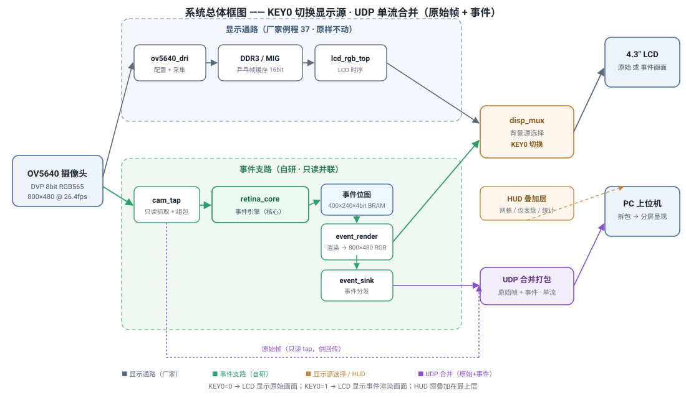
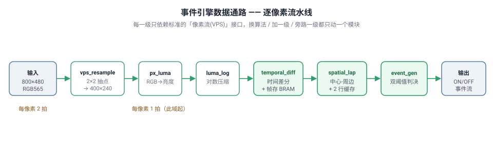

# 仿视网膜事件驱动视觉前端 —— 作品说明书

> **面向读者**：非 FPGA 专业的评委老师、电子技术爱好者、以及任何想"用一篇文章看懂这个作品"的人。
> 本文用**框图、示意画面、数据对比**说话，尽量少用术语；遇到必要术语会在文末**附录：术语表**统一解释。
>
> **赛事**：2026 全国大学生嵌入式芯片与系统设计竞赛 · FPGA 创新设计赛道 · AMD 自主选题赛道（初级组）
> **平台**：正点原子 达芬奇Pro（AMD Artix-7 **XC7A100T-FGG484-2**）· 摄像头 OV5640 · 4.3 寸 800×480 LCD

---

## 摘要（一页看懂）

传统摄像头像一台"**每秒拍几十张完整照片的机器**"：无论画面里有没有东西在动，它都把整幅画面的每一个像素
一帧一帧地全部送出去。我们用一个 FPGA 芯片，模仿生物视网膜的工作方式，把它改造成"**只报告'哪里变了'的传感器**"：

| | 传统帧式相机 | 本作品（事件驱动） |
|---|---|---|
| **输出什么** | 每一帧的完整画面（所有像素） | 只有亮度发生变化的像素（ON/OFF 事件） |
| **静止场景** | 仍在不停传输整帧 | **输出趋近于 0** |
| **数据量** | 固定，与画面内容无关 | 与"运动量"成正比 |
| **冗余** | 静止画面 99% 是重复信息 | 无变化即无输出，天然无冗余 |

**一句话定位**：*在 FPGA 上，用纯数字逻辑把"普通帧式摄像头"变成"只对变化敏感的仿视网膜事件视觉前端"。*

---

## 1. 它解决什么问题

### 1.1 传统帧式视觉的两个"结构性浪费"

传统摄像头以固定帧率（比如每秒 30 帧）连续输出整幅画面。这带来两个不是"优化技巧"能解决的浪费：

1. **带宽与功耗浪费**：无论画面是否变化，每个像素每帧都被采集、传输、计算。一片静止的监控画面，
   其实 99% 的内容和上一帧一模一样，却仍在以满带宽搬运。
2. **延迟浪费**：必须等"一整帧"采完才能开始处理，从"光进入镜头"到"系统知道发生了变化"，
   天生就晚了一个帧周期（约 33 毫秒）。

### 1.2 生物视网膜是怎么做的（启发来源）

人眼和大多数动物的视网膜**并不逐帧搬运完整画面**。视网膜里的**神经节细胞**只对"**光强发生变化**"这一件事敏感：

- 一个区域**变亮** → 发出一个 **ON（开）** 信号；
- 一个区域**变暗** → 发出一个 **OFF（关）** 信号；
- 一个区域**没变化** → **什么都不发**。

这就是"事件驱动"：**用变化触发输出，而不是用固定节拍搬运全部内容。**

> 业界已经有人把这种原理做成了专用芯片（即"事件相机 / 动态视觉传感器 DVS"），
> 它们在高速运动、低延迟、高动态范围等场景表现突出，但**价格昂贵、分辨率有限、且是专用传感器**。
>
> 本作品的思路不同：**不买专用传感器，而是在普通 30 元级的 CMOS 摄像头后面，用一片 FPGA
> 实时"算"出等效的事件流**——用可编程逻辑在数字域复现视网膜的"中心-周边感受野 + 阈值发放"机制。

---

## 2. 系统长什么样（框图与数据流）

### 2.1 总体框图

整个系统由两条并行的通路组成，关键是"**事件支路只读并联、绝不打扰显示通路**"：

- **上排（显示通路）**：摄像头 → DDR3 帧缓存 → LCD，这条通路是**原封不动**的成熟方案，输出"原始画面"。
- **下排（事件支路，本作品核心）**：在摄像头的信号线上**只读地"旁听"一路**，送入 <code>retina_core</code>
  事件引擎，算出 ON/OFF 事件，再由 <code>event_render</code> 渲染成"事件画面"（变亮红、变暗蓝、余晖渐隐）。

**两个让演示更直观的设计**：

1. **按键切换显示源**：按一下 **KEY0**，LCD 就在"原始摄像头实景"与"事件热图"之间一键切换，无需两套屏幕；
   仪表盘、统计条等 HUD 信息恒叠加在最上层，两种模式都看得见。
2. **一根网线传两样**：UDP 回传时把"原始帧 + 事件"**打包进同一条流**，PC 上位机拆包后**分屏分别呈现**原始画面与事件图。

> **为什么这样设计**：显示通路是"已经上板验证、一字节不改"的底座；事件支路是"新增的增量创新"。
> 两者物理隔离——即使事件支路出问题、甚至拔掉网线，原始画面照常显示，互不拖累。这大幅降低了工程风险。

### 2.2 事件引擎的数据流

事件引擎内部是一条**逐像素的流水线**，摄像头送进来的每一帧画面，都会依次经过下面几个环节：

| 环节 | 做了什么 | 通俗理解 |
|---|---|---|
| <code>vps_resample</code> | 800×480 → 400×240 抽点 | 降分辨率，把运算量降 4 倍，事件仍足够密 |
| <code>px_luma</code> | 彩色 → 亮度 | 只关心"明暗"，丢掉颜色 |
| <code>luma_log</code> | 亮度取对数 | 让"相对变化"变成"绝对差值"，更符合人眼感知 |
| <code>temporal_diff</code> | 和上一帧相减 | **"这个像素变了多少"** |
| <code>spatial_lap</code> | 四邻域中心-周边运算 | **"它和周围相比是不是边缘/亮点"** |
| <code>event_gen</code> | 双阈值判决 | **"变化够大吗？是变亮还是变暗？"** → ON/OFF |

---

## 3. 核心原理（通俗但严谨）

### 3.1 "中心-周边感受野"到底是什么意思

这是全篇最容易被术语劝退的概念，其实一句话就能讲清：

> **视网膜的一个神经节细胞，不是只看"一个点"的亮度，而是拿"中心一小块"和"周边一圈"作比较：**
> 中心比周边亮得多，就强烈响应；中心和周边一样亮（比如一大片均匀的背景），就几乎不响应。

生物学上这叫 **中心-周边（center–surround）拮抗感受野**，它的数学描述是"**高斯差分（DoG）**"。
它的作用是**突出边缘、抑制大面积均匀背景**——这正是"只对变化敏感、对均匀区域无感"的生物学基础。

在 FPGA 里，我们用**整数四邻域拉普拉斯算子**（中心像素 ×4，减去上下左右 4 个邻居）来近似它：

<pre>中心-周边响应 = 4 × 中心像素 − (上 + 下 + 左 + 右)</pre>

这一行只有**加减法和一个移位**，**不需要浮点、不需要乘法器**，非常适合硬件实现。

### 3.2 三步合成一个事件

把"视网膜发放脉冲"这件事，拆成三个可以在硬件里逐拍完成的步骤：

1. **时间差分**：<code>变化量 = 本帧亮度 − 上一帧亮度</code>（存一帧历史即可）。
2. **空间滤波**：对"变化量"再做一次中心-周边运算，突出边缘、压掉全局漂移。
3. **双阈值判决**：变化量超过正阈值 → 发 **ON**；低于负阈值 → 发 **OFF**；在中间 → **不发**。

阈值默认取 **θ ≈ 0.2（自然对数单位）**，即**约 22% 的相对亮度变化**才会触发一个事件，
并且这个阈值可在运行时调节（更灵敏或更迟钝）。

> **为什么用对数亮度**：人眼和 DVS 都用对数域，因为"从 10 涨到 11"和"从 100 涨到 110"在感知上同样明显
> （都是约 10% 的变化）。取对数后，"相对变化率"变成了"绝对差值"，于是阈值就是一个固定的加法比较，硬件实现极其简单。

### 3.3 ON 与 OFF：不是两套电路

一个关键简化：**ON 和 OFF 是同一个"中心-周边响应"的正半波与负半波**。
硬件里只需要一条数据通路，最后用一个"符号判断 + 阈值比较"就同时得到两类事件，不需要做两套滤波器。

---

## 4. 采集到的画面 vs 我们的输出（可视化对比）

下图用同一时刻的**同一个场景**，对比"传统相机输出"与"本作品输出"的差异：

帧相机 vs 事件驱动（图 ../assets/frame_vs_event.svg，未随包发布）

- **左边（传统帧式相机）**：把整幅画面（包括大片不变的背景）一个像素不落地全部输出——数据量恒定，冗余巨大。
- **右边（本作品）**：只有物体**运动边缘**的像素被报告——变亮处标 **红（ON）**、变暗处标 **蓝（OFF）**，
  其余静止区域**保持黑、零输出**。

> 观察要点：物体**内部**（整块均匀亮区）和**背景**（整块均匀暗区）都不产生事件，
> 因为它们"和周围/和上一帧相比没变"；真正有价值的信号只在**边缘**上。这就是"稀疏"的含义。

---

## 5. 性能对比（预计估计值）

> 以下数字是**基于架构的预计估计值**，用于说明量级与趋势；**精确数值待上板实测后以实验报告回填**
> （符合本项目"估计值必须标注、可被后续实测证伪"的工程约定）。

### 5.1 数据量降低（核心卖点）

基线：帧相机每帧固定输出 <code>800×480×16 bit = 6.14 Mbit</code>；本方案每个事件约 24 bit（坐标 + 极性）。

数据量降低倍数（图 ../assets/data_reduction.svg，未随包发布）

| 场景 | 每帧变化像素占比 | 帧相机数据量（固定） | 事件流数据量 | **数据量降低倍数** |
|---|---|---|---|---|
| 静止场景 | ≈ 0 | 6.14 Mbit | ≈ 0 | **趋近 0（≈∞×）** |
| 稀疏运动（如单人走过） | ≈ 0.1% | 6.14 Mbit | ≈ 2.3 Kbit | **≈ 2700×** |
| 中等运动 | ≈ 1% | 6.14 Mbit | ≈ 23 Kbit | **≈ 270×** |
| 密集运动 | ≈ 10% | 6.14 Mbit | ≈ 230 Kbit | **≈ 27×** |
| 满屏剧烈变化 | ≈ 100% | 6.14 Mbit | ≈ 2.3 Mbit | **≈ 2.7×** |

**一句话结论**：**运动越少，省得越多**。在监控、值守等"绝大多数时间画面静止"的场景里，
事件驱动能把有效数据量压缩 **2~3 个数量级**；只有当整幅画面都在剧烈变化时，收益才收敛到个位数。

### 5.2 延迟（响应速度）

| | 传统"整帧处理" | 本方案（全流水线） |
|---|---|---|
| 从"变化发生"到"系统知道" | ≥ 1 帧周期（约 33 ms） | **逐像素流式处理**，延迟 = 固定流水级数 + 2 行缓存 |
| 是否有操作系统/中断抖动 | 可能有 | **无处理器、无中断**，延迟是**确定的**、可逐级写预算并实测 |

> 这是"纯硬件实现"的结构性优势：没有操作系统调度、没有 DMA 排队，端到端延迟可以像算电路一样精确写出来。

### 5.3 资源与功耗（面向 FPGA 的工程指标）

- **纯 Verilog、零处理器**：不占用 CPU、不跑操作系统，整条视觉前端在 FPGA 逻辑里完成。
- **片内 BRAM 占比约 40%**（预计）：事件引擎的帧存、位图、行缓存全部走片内块内存，
  **不依赖外部 DDR3**（DDR3 只留给显示通路），也**不使用 DSP 乘法器**。
- 显示通路本身只占片内 BRAM 的约 11%，事件引擎有充足余量。

---

## 6. 什么时候用传统方案，什么时候用本方案

**没有"谁全面碾压谁"，只有"谁更适合这个场景"。** 给出可直接参考的选型建议：

| 维度 | 建议传统帧式相机 | 建议事件驱动（本方案） |
|---|---|---|
| 需要什么 | 完整的、可给人看的图像 | 只需要"哪里有变化 / 什么时候变" |
| 典型场景 | 拍照、录像、识别、存档 | 高速运动检测、长时间值守监控、运动触发 |
| 带宽/存储 | 恒定，与内容无关 | 与运动量成正比，静止场景近乎零 |
| 延迟 | 至少晚一帧 | 逐像素流式，近乎实时 |
| 功耗 | 恒定（满帧计算） | 随活动量下降，静止时极低 |
| 时间分辨率 | 由帧率决定 | 同样受帧率限制（见 §8 局限） |
| 动态范围 | 常规 | 对数域天然抗光照整体变化 |

**典型适用场景**：传送带/产线上的**计数与掉落检测**、**入侵告警**、**运动触发抓拍**、
机器人/无人机的**低延迟视觉触发**、以及需要"长时间低功耗待机、有事才醒"的边缘视觉节点。

---

## 7. 前景与商用价值

### 7.1 技术方向的前景

事件视觉（Event-based Vision）是当前**计算机视觉与边缘智能的前沿方向**之一，国际学界与产业界正在快速推进：

- 专用事件传感器（DVS/DAVIS/ATIS）已在**高速运动、低延迟、高动态范围**场景证明价值，
  并开始进入**自动驾驶、工业高速检测、消费电子**等产品。
- 本作品的定位是**"用通用 FPGA + 普通 CMOS 相机，数字合成事件流"**，不依赖昂贵专用传感器，
  **成本低、可重构、易量产**，是事件视觉"平民化"的一条务实路径。

### 7.2 可落地的商业/应用价值

| 应用方向 | 本作品带来的价值 |
|---|---|
| **工业高速检测** | 传送带计数、落件/卡料检测、高速产线异常触发，带宽与算力随"有效运动"伸缩 |
| **安防与值守监控** | 长时间低功耗待机、事件触发抓拍与告警，显著降低传输与存储成本 |
| **机器人 / 无人机** | 低延迟"变化即响应"，适合需要快速避障/触发/跟踪的端侧视觉 |
| **边缘 AI 的前置筛选** | 作为"稀疏事件前端"，先筛掉静止冗余，再交给后级网络，降低整体算力与功耗 |
| **可复用的 IP 核** | 事件编码流水线可封装成 FPGA **IP 核**，与帧式相机融合（类 DAVIS 思路），供更多产品复用 |

### 7.3 一句话总结价值

> 本作品不是"又一个 FPGA 图像处理 demo"，而是把一个**正在起量的前沿传感范式（事件视觉）**
> 用**最通用、最便宜的硬件**实现出来，并在**成本、带宽、延迟、功耗**四个维度给出可量化的收益。

---

## 8. 诚实的局限（我们主动说，不回避）

好的产品报告应当如实说明边界。本方案的局限如下：

1. **时间分辨率仍受帧率限制**：输入是普通 30 fps 摄像头，所以事件的"时间精度"约为一个帧周期
   （约 33 ms），**比专用 DVS 的微秒级慢约 3 个数量级**。这是"用普通相机换成本"的合理工程取舍。
2. **事件分辨率 400×240**：低于相机原生 800×480，是"用分辨率换稀疏性/资源"的权衡。
3. **每像素每帧至多 1 个事件**：帧扫描架构下，一次变化只发一个事件，高速运动下可能低估事件率。
4. **不是独立的完整相机**：它需要一个帧式摄像头作为输入，输出的是"变化流"而非完整图像，
   需要配合一路常规显示/存档才能构成完整系统（本作品已经做到了：显示通路与事件支路并存）。

---

## 附录：术语表（通俗解释）

| 术语 | 通俗解释 |
|---|---|
| **事件（Event）** | 一次"这个像素的亮度发生了变化"的报告，含坐标、极性（变亮/变暗）、时间。 |
| **ON / OFF 事件** | ON = 变亮，OFF = 变暗。像视网膜里两类神经节细胞。 |
| **中心-周边感受野（center–surround）** | 神经细胞拿"中心一小块"和"周边一圈"作比较，突出边缘、抑制均匀背景。 |
| **高斯差分（DoG）** | 中心-周边感受野的标准数学模型；本作品用整数拉普拉斯近似，省硬件。 |
| **时间差分（temporal diff）** | 本帧减去上一帧，得到"变化量"。 |
| **阈值（threshold θ）** | 变化量要超过它才发事件；默认约 22% 相对亮度变化，可调。 |
| **对数亮度（log luminance）** | 把亮度取对数，让"相对变化"变成"绝对差值"，抗光照整体变化。 |
| **FPGA** | 现场可编程门阵列，一种可反复重写的数字芯片，本作品的运行载体。 |
| **BRAM** | FPGA 片内的块式存储器，读写延迟极低（1~2 拍）。 |
| **DDR3 / MIG** | 片外大容量内存及控制接口；本作品只用它做"显示帧缓存"，事件数据不走它。 |
| **DVS / 事件相机** | 直接以"事件"形式输出画面的专用传感器，是事件视觉的硬件实现。 |
| **并联 tap** | 在摄像头信号线上"只读旁听一路"，不改动原有通路。 |

---

*本文档属于工程文档体系，编号 01_产品报告/product_manual.md；技术细节见 02_系统设计/、03_技术原理/。*