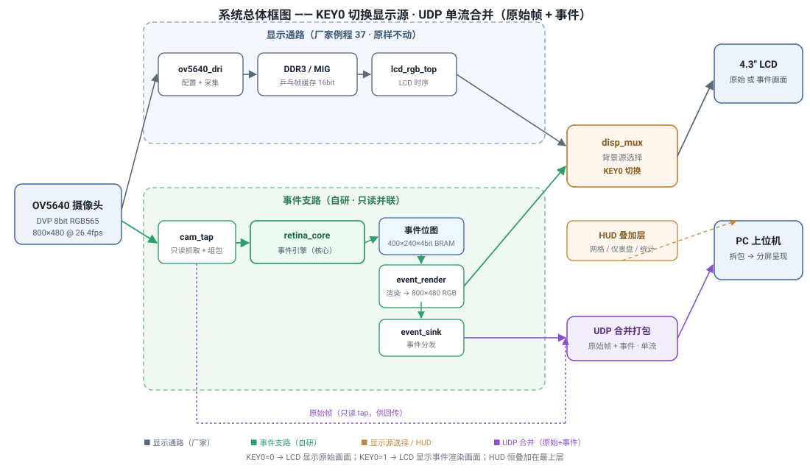
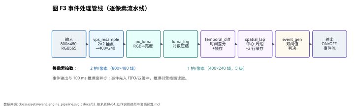
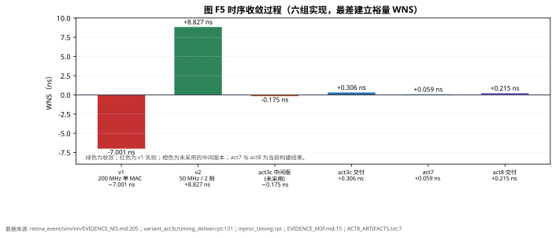

<div align="center">

**仿视网膜事件驱动视觉系统设计报告**

正点原子达芬奇Pro · AMD Artix-7 xc7a100tfgg484-2

2026 全国大学生嵌入式芯片与系统设计竞赛 · FPGA 创新设计赛道

</div>

> 版本：2026-10-31。数字口径以 [参赛口径登记](../docs/06_facts/02_metric_register.md) 为唯一权威；正文首次出现时标注 D8 编号。v7b 的部署裁决与风险接受见 [v7b 部署裁决记录](../docs/06_facts/03_v7b_deployment_decision.md)。
> 板上交付为 variant_act8_final（v7b 两分类权重 + NN_MARGIN_MIN=16，2026-10-31 02:02 烧板，DONE_PIN=1 / EOS=1 / PROG_RESULT=OK）。act7（v7 前端）已完成整机构建但未烧板；act8 的位流、时序与资源已实测，空场景被动基线为零误报（20.1 分钟带录像 + 4 小时连续监测）；v7b（act8）的 A1~A4 动作段验收已于 2026-10-31 完成 4 轮（3 轮有效：A3 召回 0.70–0.95、累计 48/60=0.80，A1/A2 零误触，A4 共 1 条；G2 未稳定达标）；v7 未烧板，其板级数字仍未产生。
> 类别语义以 [动作回传与上位机契约](../docs/03_tech/05_action_uplink_contract.md) 为准：class0 无动作、class1 手部开合、class2 横向挥手、class3 保留；旧文档中的“握拳→张开/张开→握拳”仅作历史表述。
> 匿名声明：按赛事要求，本报告不包含学校名称与指导教师姓名。

# 选题背景与创新点

本章给出选题判断与设计边界：项目面向“静态场景占多数、只关心变化”的视觉前端，用一块 Artix-7 完成事件生成、显示、回传与片上动作推理。核心指标是事件链路可用、动作决策确定、资源与时序可复现；不追求通用视觉大模型的吞吐。

## 1.1 问题定义

帧式相机按固定帧率搬运算术上完整的像素阵列。800×480、60 fps 的原始数据量约 23 Mpx/s，静态背景下的绝大多数像素没有信息增量。事件相机只在上报亮度变化的像素，静态场景的事件率接近零；典型 DVS/ATIS 用模拟像素电路实现这一机制，传感器与配套生态是专用路线。

本设计选择另一条工程路径：用常见 OV5640 采集 800×480 画面，在 FPGA 内用数字运算近似视网膜的时间差分与中心-周边响应，输出 400×240 稀疏事件；显示、回传、动作推理共用同一套事件流。该路径降低了对专用传感器的依赖，代价是事件质量受 CMOS 曝光与噪声限制，事件分辨率低于原始画面。

这类前端适合三类场景。第一类是长期在线、但大部分时间没有变化的监视任务，例如工位状态、设备面板、出入口区域；事件率低时链路与存储压力小，静态背景不产生持续写入。第二类是人机交互，手部动作本身就是稀疏事件，板上完成二分类即可触发本地逻辑，不需要把原始视频送到云端。第三类是带宽受限的嵌入式设备，1 Gbit/s 以太网与单板 FPGA 的预算内，事件流比原始帧更容易裁剪与调度。

本设计不把“低带宽”当作唯一目标。事件流的价值在于时间分辨率与稀疏性：亮度变化一旦发生就立即上报，不受固定帧率限制；静态场景下没有事件，后级处理可以休眠。代价是事件流不携带完整纹理，颜色、文字、细节都需要原始帧通路补足。因此系统保留原始帧回传与录像，事件流负责触发与交互，两条通路分工明确。

## 1.2 设计边界

本设计是数字域的功能近似，不复现硅视网膜的模拟电路行为。板上事件网格固定 400×240，动作模型为 int8 二分类，每 100 ms 推理一窗。当前板上位流只输出 class0（无动作）与 class1（手部开合）；class2（横向挥手）的语义在契约中保留，v5 位流不产生该类别（D8-A1、D8-A3、D8-M7）。

本版未覆盖的部分单独标注：v7 数据集与离线模型已完成，v7b（act8）的 A1~A4 上板验收已完成（3 轮有效：A3 累计 48/60=0.80、A1/A2 零误触、A4 1 条，G2 未稳定达标）；act8 空场景被动基线已完成（20.1 分钟带录像 + 4 小时连续监测，合计 241.2 分钟、0 条动作事件），但它只覆盖无人静态场景，不能替代动作段验收；act7 整机位流已构建但未烧板；act8 已烧板。设计报告只引用离线结果、构建实测与已复跑的板上基线，不用离线数字替代板上验收。

设计目标可以拆成四条可检查的约束。事件链路要在 1 Gbit/s 以太网上稳定回传 600 包/帧，丢包与丢事件可计数；动作决策要在 100 ms 窗内完成，单窗推理不超过窗长的 10%；实现资源要留出余量，Slice 不超过 50%、BRAM 不超过 70%；复现要能在 Windows 与 Vivado 2020.2 上按脚本重跑。四条约束分别对应链路、实时性、资源与可复现性，后续章节按这四条组织证据。

四条约束之间存在取舍。提高事件分辨率会增加位图与差分帧存，BRAM 先撞上限；提高推理并行度会改善时延，但 Slice 与时序先撞上限；提高动作类别数会增加 FC 与 ROM，但不会线性增加卷积开销。设计选择先把二分类做稳，再评估三分类与时间深度，避免一次改动同时动分辨率、类别与并行度，导致问题无法归因。

## 1.3 四个创新点

| 编号 | 创新点 | 实现位置 | 可核验证据 |
|---|---|---|---|
| C1 | 事件驱动稀疏输出：只上报亮度变化，静态场景事件率趋零 | retina_core.v、event_gen.v、udp_merge.v | 上板事件流、600 包/帧装配、用户面板 pps≈15,940（D8-H6） |
| C2 | 数字域中心-周边算子：四邻域拉普拉斯 4c−Σ4，零乘法器 | spatial_lap.v | 仿真波形、事件位图与显示叠加（D8-M5） |
| C3 | 时间-空间级联与三重整形：时间差分、空间算子、阈值/极性/不应期 | temporal_diff.v、spatial_lap.v、refractory.v | 73 个 testbench 全量回归（NN 三个 TB 合计 517 条 CHECK；D8-M2） |
| C4 | 全片内事件通路：显示用厂家 DDR3，事件与 NN 走片内 BRAM | top_retina_event.v、nn_top.v | act3c 资源 87/135 BRAM、DSP 7/240（D8-R2） |

四个创新点的共同约束是“事件不落外存、决策不进软件回环”。显示帧缓存需要 800×480×16 bit 的容量，片内 BRAM 放不下，工程复用厂家 DDR3/MIG 显示底座；事件位图、时间差分帧存、NN 权重与激活全部留在片内（D8-R7）。

C1 的难点在阈值与噪声。固定阈值在暗光下会漏事件，在亮光下会爆事件；设计用对数亮度把乘性变化变成加性差值，再用可配置阈值 θ 适配场景。C2 的难点在算子代价。高斯核需要乘法，四邻域拉普拉斯只需要 4c−Σ4，系数全为 1，综合后不占 DSP。C3 的难点在级联顺序。先时间差分再空间算子，事件数已经被时间维压过一次，空间算子只需处理候选点；反过来做会让空间算子扫描全图。C4 的难点在存储层级。事件位图必须支持同拍读改写与显示只读，单口 BRAM 做不到，因此用双口 BRAM 分时；显示帧缓存则必须离开片内。

四个创新点分属同一数据通路的不同环节：C1 决定事件率，C2 决定事件质量，C3 决定通路确定性，C4 决定延迟可控性。去掉 C1，链路与 NN 会被原始帧淹没；去掉 C2，噪声事件会进入 NN，误触发升高；去掉 C3，事件质量与延迟不可控；去掉 C4，事件通路会被外部存储的随机延迟打断。四者缺一，系统都无法在满窗条件下实时运行。

## 1.4 关键指标

| 指标 | 数值 | 口径来源 | 核验位置 |
|---|---:|---|---|
| 目标器件 | xc7a100tfgg484-2 | D8-M1 | [retina_event.xpr](../build/build_inproc_v7.tcl) |
| 系统时钟 | 50 MHz | D8-M3 | retina_event.xdc（文件 ../retina_event/src/constraints/retina_event.xdc，未随包发布） |
| 摄像头输入 | 800×480、RGB565、8 位 DVP、PCLK≈48 MHz | D8-M4 | [契约 v1.3 §2](../docs/03_tech/05_action_uplink_contract.md) |
| 事件网格 | 400×240 | D8-M5 | [retina_core.v](../src/rtl/subsys/retina_core.v) |
| 事件回传 | 600 包/帧、5 B/事件记录 | 契约 v1.3 §2 | [契约 v1.3 §2](../docs/03_tech/05_action_uplink_contract.md) |
| 动作模型 | int8 二分类、100 ms/窗 | D8-A1 | [契约 v1.3 §7](../docs/03_tech/05_action_uplink_contract.md) |
| 单窗推理 | 8.80 ms、440,087 拍 @50 MHz | D8-R5 | [EVIDENCE_M3.md](../sim/nn/EVIDENCE_M3.md) |
| act3c 实现资源 | LUT 20,559、FF 11,850、Slice 7,327、BRAM 87、DSP 7 | D8-R2 | [EVIDENCE_M2E.md](../sim/nn/EVIDENCE_M2E.md) |
| act3c 最终时序 | WNS +0.306 ns、TNS 0、WHS +0.036 ns | D8-R1 | [EVIDENCE_M2E.md](../sim/nn/EVIDENCE_M2E.md) |
| act3c 位流 | 2,890,875 B、md5 a5fff751… | D8-M6 | [00_current_status.md](../docs/06_facts/00_current_status.md) |
| act7 构建（未烧板） | LUT 22,371、FF 14,325、Slice 7,968、BRAM 87、DSP 8、IOB 140；WNS +0.059 ns、WHS +0.027 ns | D8-M9、D8-R9 | [act7 时序报告](../build/variant_act7/timing_deliver.rpt) |
| act8 构建（已烧板） | LUT 22,383、FF 14,325、Slice 8,026、BRAM 86.5、DSP 8、IOB 140；WNS +0.215 ns、WHS +0.017 ns | D8-M12、D8-R12 | [EVIDENCE_M3j.md](../sim/nn/EVIDENCE_M3j.md) |
| act8 空场景基线 | 带录像 20.1 分钟 + 连续监测 240.1 分钟，均 0 条动作事件、0.00 次/分；0 事件 95% 上界 0.149 / 0.0125 次/分 | D8-M13 | 空场景基线（文件 ../docs/05_experiments/action_recognition_20261029/act8 空场景基线_20261031.md，未随包发布） |

指标表只列已核实口径。v7 板级功能不在表中，因为 v7 未烧板；act8 的 A1~A4 上板验收结果单列在 4.3.3 节；空场景基线已单列，它只证明“无人静态场景 20.1 分钟零动作事件”，不证明动作段召回；act7/act8 的资源与时序已列；act7 未烧板，act8 已烧板，两者都不能替代板级动作验收。训练侧的离线准确率单列在 4.3 节，并标注“离线”。把未测数字留空，比用训练集准确率填充更能反映工程状态。表中第四列给出每个数字的核验入口；评审可以按路径打开实现、约束或证据文件，不依赖本报告的自述。

指标之间并不独立。单窗推理 8.80 ms 决定了 100 ms 窗内还有约 91 ms 余量给事件搬运与显示；BRAM 87/135 决定了还能再加约 48 个 BRAM36；act3c 的 Slice 46.23% 决定了新增逻辑要控制在约 600 个 Slice 以内。act7 构建后 Slice 升至 50.27%，act8 为 50.64%，已越过 50% 线，新增逻辑的余量比 act3c 时更紧；后续评估任何新功能，都先看这三个余量，再看功能收益。

## 1.5 与前人工作的差异

| 路线 | 机制 | 代价 | 本设计的差异 |
|---|---|---|---|
| 模拟 DVS/ATIS | 像素内模拟电路直接产生事件 | 专用传感器、供货与工具链受限 | 用商用 OV5640 + FPGA 数字近似，事件质量受曝光与噪声约束 |
| 帧式相机 + PC 视觉 | 每帧全量传回主机，主机跑 CNN | 链路带宽与主机算力占用高 | 事件在板上生成，动作在板上推理，主机只做显示与记录 |
| FPGA CNN 加速器 + DDR | 权重/激活放外部存储，追求高吞吐 | 外存带宽与板级复杂度上升 | 事件引擎与 NN 全部片内 BRAM，资源余量可查（D8-R7） |
| 纯主机录制/回放 | 先把原始流落盘，离线分析 | 无法在线决策，时延不可控 | 板上 100 ms 窗决策，事件经 byte23 与 HTTP 同步到上位机 |
| YOLO 类通用检测 | 大模型、多类别、强算力 | 单窗 MAC 20,900 倍于本设计，超器件 BRAM 5.3 倍 | 二分类小模型，207,840 MAC/窗，8.80 ms 完成 |

表中的“20,900 倍”与“5.3 倍”来自选型阶段的预算比较，详见 [动作识别选型与资源预算](../docs/03_tech/04_action_recognition_selection.md)。比较用于说明在本器件 135 个 BRAM、240 个 DSP 的边界内，二分类事件模型是能落地的选择；通用模型在算力充足的平台上仍然适用。

比较口径需要说明。MAC 数是单窗前向的乘加计数，不含数据搬运与量化；BRAM 是权重与激活的静态占用，不含运行时双缓冲；时延是板上单窗推理时间，不含事件窗累计的 100 ms。不同论文的 MAC 统计口径可能不同，因此表中只做数量级比较，不把倍数当作性能结论。

# 设计原理与功能框图

本章给出系统原理与数据流：摄像头像素进入事件引擎，事件分三路去显示、回传、推理；上位机只做装配、可视化、记录与标注。功能框图见 [system_architecture.svg](../docs/assets/system_architecture.svg)，管线时序见 [event_engine_pipeline.svg](../docs/assets/event_engine_pipeline.svg)。

## 2.1 系统总框图

系统由五个域组成：采集域（cam_pclk）、事件域（clk_cam 50 MHz）、显示域（clk_lcd）、以太网域（eth_rxc 125 MHz）、上位机域（PC）。跨域只通过异步 FIFO 与两级同步器传递状态，事件坐标与时间戳在事件域生成，显示域只读事件位图，不反向写事件通路。



五个域的时钟来源不同，复位策略也不同。cam_pclk 来自摄像头，约 48 MHz，不能当作全局时钟；clk_cam 由板载 50 MHz 晶振经 MMCM 产生，事件引擎、NN 与 UDP 打包都在这个域；clk_lcd 来自显示控制器，约 25 MHz；eth_rxc 由 PHY 恢复，125 MHz。跨域信号一律先进异步 FIFO 或两级同步器，禁止组合逻辑直接跨域。

| 节点 | 输入 | 输出 | 关键实现 |
|---|---|---|---|
| 采集 | OV5640 DVP 8 bit | 800×480 RGB565 像素流 | cam_tap 只读并联，不改厂家采集时序 |
| 预处理 | RGB565 | 400×240 亮度 | vps_resample ÷2×÷2、px_luma、luma_log |
| 事件生成 | 当前/上一帧亮度 | 400×240 事件位图 | temporal_diff、spatial_lap、event_gen、refractory |
| 显示 | 原始像素 + 事件位图 | 800×480 LCD | 厂家 DDR3/MIG 底座、disp_mux、HUD 叠加 |
| 回传 | 原始帧 + 事件记录 | UDP v3 包 | udp_merge 24 B 头、600 包/帧、CRC16 |
| 推理 | 100 ms 事件窗 | class0/class1 + CONF | nn_feat、nn_engine、nn_decide |
| 上位机 | UDP 包 | 画面、统计、录像、标注 | Node/TS 网关、Web 前端、HTTP/WS |

数据流的核心是“一份事件、三处消费”。事件位图写入后，显示域按扫描顺序读取，UDP 域按包组装读取，NN 域按 100 ms 窗累计读取。三处消费者不互相阻塞：显示读取优先级最低，UDP 满包优先发送，NN 在窗边界锁存。事件位图的读口因此需要仲裁，仲裁策略是“写入优先、UDP 次之、显示最低”，避免显示扫描把事件写入挤掉。

原始像素另走一条并联通路。摄像头像素同时进入显示帧缓存与 UDP 原始段，事件引擎只旁路监听，不修改像素。这样做的收益是显示与事件互不依赖：即使事件引擎复位，LCD 仍能显示原始画面；即使显示帧缓存未初始化，事件仍能回传。代价是两套通路的带宽要分别预算，RAW_EV 模式下每帧 600 包、每包 1,280 B 原始段加事件段。

## 2.2 事件生成原理

事件生成分四步。1）亮度变换：RGB565 转 Y，再用 256 项对数 ROM 压到 11 bit，使阈值对应相对亮度变化。2）时间差分：当前帧与上一帧的亮度差与阈值 θ 比较，得到 ON/OFF 候选。3）空间算子：对候选做四邻域拉普拉斯 4c−Σ4，抑制孤立噪声、保留边缘与运动前沿；该算子只用加法和移位，不占 DSP。4）不应期与位图写入：同一像素在不应期内不重复触发，事件写入位图 BRAM，供显示与回传读取（D8-M5）。



*图 F3：800×480 RGB565 输入经 ÷2×÷2 降采样、亮度变换、对数压缩、时间差分、中心-周边算子与双阈值判决，输出 400×240 ON/OFF 事件流；每像素 2 拍，事件输出与 100 ms 推理窗异步。数据源：docs/assets/event_engine_pipeline.svg、docs/03_tech/04_action_recognition_selection.md。*

事件位图的组织是 16 bit 地址、8 bit 数据，2 个像素共用 1 个字，共 48,000 字。A 口在 clk_cam 做读-改-写，B 口在 clk_lcd 只读。帧末余晖扫描 48,000 字×2 拍 = 96,000 拍，约 1.92 ms @50 MHz，占 37.9 ms 帧周期的 5%；写入优先，扫描可暂停。该设计避免了逐像素衰减扫描对事件写入的阻塞。

事件生成的整数近似可以写成四步。亮度变换为 L = round(256 × log2(Y))，Y 取 1..255，L 落在 0..2047；时间差分为 ΔL = L(t) − L(t−1)，|ΔL| 与阈值 θ 比较，符号给 ON/OFF；空间响应为 S = 4c − (n + s + e + w)，c 是中心像素，四邻域取上一帧亮度，S 与空间阈值比较；再按极性、密度与不应期整形，写入位图。四步都只用加减、比较、移位与一张 256 项对数 ROM，没有乘法器。

阈值不是固定常数。θ 可由上位机通过下行 TLV 配置，范围 0..4095；默认值按室内光照标定，暗光下降低、亮光下提高。阈值过低会把传感器噪声当事件，阈值过高会漏掉慢速手势。工程上用“事件率随 θ 单调下降”作为标定依据：先固定场景，扫 θ，记录每秒事件数，再选事件率与动作召回都能接受的折中点。这个折中点不是全局最优，但可复现。

## 2.3 动作识别原理

动作识别把事件流切成 100 ms 不重叠窗。每窗在 50×30 网格上累计 4 个通道：当前窗 ON、当前窗 OFF、上一窗平移后的 ON、上一窗平移后的 OFF。平移量取上一窗质心相对画面中心的偏移，RTL 侧只用减法与 clamp，不引入乘法器。4 通道送 3 层卷积与全连接，输出 2 个 logit；int8 权重与激活由训练侧量化后写入 ROM（D8-A1、D8-R6）。

决策层不直接采信单窗结果。连续 3 窗同类才锁存一次动作；class0 永不产生脉冲；1.5 s 不应期内不重复计数；空窗 1.0 s 清零（D8-A2）。这套节拍把单窗误判压到秒级，代价是动作起始有约 300 ms 的确认延迟。对“开合手”这类持续动作，300 ms 延迟不影响交互；对单次快速挥手，确认窗可能错过上升沿，这是 v5 把挥手映射到 class0 的直接原因。

4 通道的构造决定了模型看到什么。当前窗 ON/OFF 是 50×30 网格上的饱和计数；上一窗平移通道先把上一窗质心对齐到画面中心，再累计 ON/OFF。平移量为 shift_x = prev_cx − 200、shift_y = prev_cy − 120，坐标裁剪到 0..399 与 0..239，再右移 3 位落到网格。空窗保持上一窗质心，避免质心跳变导致通道全空。该归一化让“手在画面左侧”与“手在画面右侧”共享同一套权重，减少位置偏置。

卷积层尺寸按 50×30 输入设计。conv1 取 5×5 核、8 通道，conv2 取 5×5 核、16 通道，conv3 取 3×3 核、16 通道，全连接 256 维，输出 2 个 logit。int8 权重与激活的 scale 在训练后按逐层最大值标定，RTL 侧用移位与乘加实现反量化；logit 比较用整数，不引入浮点。单窗 207,840 MAC 与 8.80 ms 的实测时间，说明 50 MHz 单 MAC 在 100 ms 预算内还有约 91 ms 余量。

## 2.4 显示与并联 tap

显示通路复用厂家 DDR3/MIG 例程：OV5640 原始像素写入 DDR3 帧缓存，LCD 控制器按 1056×525 时序扫描；事件位图在显示域叠加为红/蓝点，HUD 显示帧率、事件率、动作类别。采集 tap 只读，事件支路与显示支路互不写对方缓存。上板验证中，LCD 实时画面与网口整帧回传同时工作，PC 收到的原始帧没有叠加污染（D8-M4）。

显示时序是 1056×525、25 MHz，对应约 60 Hz 场频；实际摄像头帧率 26.6~27.0 fps，显示控制器会对同一帧重复扫描。重复扫描不改变 DDR3 中的帧内容，也不产生新事件；事件位图的余晖在帧末衰减，显示域看到的是最近一帧的事件叠加。HUD 叠加在显示域完成，不写回 DDR3，因此不影响回传原始帧。KEY0 切换显示源，用于对比原始画面与事件叠加画面；切换只改显示 mux，不改采集与事件通路。

这条通路的工程价值在于风险隔离。DDR3/MIG 的初始化、校准、刷新由厂家例程负责，自研部分只加只读 tap 与叠加层；即使事件引擎还在调试，LCD 仍能显示摄像头画面，联板时可以先确认采集与显示，再确认事件。反过来，事件引擎的复位不会影响 DDR3 控制器，避免“一个模块出错导致整板黑屏”的调试困境。

这条“并联 tap”是本项目能快速联板的前提。厂家例程已经解决 DDR3 初始化、LCD 时序与摄像头配置；自研部分只接只读 tap 和事件通路，避免在显示底座上重写一遍高风险逻辑。代价是显示帧缓存占 DDR3 带宽，事件通路不能假设 DDR3 可随时访问；事件位图与 NN 因此全部留在片内 BRAM。

## 2.5 时间基与对齐

板上时间基由 48 bit 微秒时间戳与 16 bit 帧序号共同维护。上位机记录时，frames.csv 的 frame_idx 与 t_board_ms 是唯一权威；视频容器按 30 fps 封装，只是标称值。真实板卡约 26.6~26.7 fps，同一段采集的容器时长为墙钟的 0.889，直接按容器秒数回放会快约 12.4%（D8-T1、D8-T2）。

这条规则影响所有离线分析。标注工具按 frames.csv 的 frame_idx 对齐，不受容器时间轴影响；使用 ffmpeg -ss 抽帧时，板卡秒数要乘 0.889 换算成容器秒数。事件 CSV 的 x/y 是 400×240 原始像素，转 50×30 网格要右移 3 位；把原始像素位移量直接当网格量用，会放大 8 倍（D8-T3）。

时间戳的精度也要写清楚。板上 48 bit 微秒时间戳由 50 MHz 时钟计数换算，晶振 ±50 ppm 对应约 3 ms/min，10 分钟累计约 30 ms；上位机按帧首包的 TS_US 建立时间轴，遇到时间戳回退超过 1 s 判为板卡复位，重建时间轴但不丢数据。帧序号 16 bit，26.6 fps 下约 41 分钟回绕；回绕时帧序号后退而时间戳前进，上位机按双钥判据识别，不把回绕当丢帧。

容器 30 fps 是编码器的标称值，不是采集时钟。视频帧号与 frame_idx 不是一一对应：同一个容器帧可能对应多个板卡帧，或多个容器帧重复同一板卡帧。需要精确对齐时，用 frames.csv 的 t_board_ms 找最近帧，再用该帧的 frame_idx 去 events.csv 取事件；不要用 video.currentTime 反推板卡时间。

# 软硬件划分依据与接口设计

本章给出软硬件边界与接口契约：硬实时、确定性、带宽敏感的部分放 FPGA；交互、存储、标注、可视化放上位机。划分依据是实测数据率与决策时限，不是“硬件越多越好”。

## 3.1 划分依据

事件链路在满帧 RAW_EV 模式下约 600 包/帧、26.6 fps，对应约 15,940 包/秒；每包 1,295 B 量级，折合约 165 Mbit/s（D8-H6）。事件记录必须在帧内按序写入，UDP 发送占空约 21%，任何主机侧回环都会把抖动带进采集。动作决策要求 100 ms 窗内完成 8.80 ms 推理，且不能受操作系统调度影响；这两条把事件引擎、NN 推理、UDP 打包放到 FPGA。

上位机承担三件事：把 UDP 包装配成帧与事件、把状态暴露成 HTTP/WS、把原始流与事件流落盘并提供标注。上位机的卡顿只影响显示与记录，不影响板上决策；这是划分的核心收益。反过来说，板上不做文件系统、不做视频编码、不做 UI，避免把非实时功能塞进 50 MHz 事件域。

带宽预算按满帧 RAW_EV 估算。每帧 600 个分片，每片 1,280 B 原始段加最多 165 B 事件段，再加 24 B 头与 2 B CRC；26.6 fps 下约 20.5 MB/s，折合 164 Mbit/s，占 1 Gbit/s 链路的 16.4%。RTL 发送占空约 21%，剩余带宽留给 CTRL 心跳与突发事件包。EV_ONLY 模式去掉原始段后，同带宽下事件吞吐约 8.8 倍；该模式用于高事件率场景，不用于需要原始画面的录像。

时延预算按“事件产生到上位机可见”估算。事件写入位图约 1 拍，UDP 打包等待当前包填满或看门狗触发，最坏等待约一个 MTU 的发送时间；上位机解析、装配、WS 推送各占毫秒级。板上推理 8.80 ms 与 100 ms 窗累计是另一条链路，动作字节随下一帧首包回传。两条链路的时延不叠加，事件流用于画面，动作流用于交互。

## 3.2 软硬件功能划分

| 功能 | 实现位置 | 判据 / 证据 |
|---|---|---|
| 事件生成 | retina_core.v、event_gen.v、spatial_lap.v | 73 个 TB 全量回归；上板事件流 |
| 事件位图与显示叠加 | event bitmap BRAM、display_path.v、hud_inject.v | LCD 目视 + 回传原始帧无污染 |
| UDP v3 打包 | udp_merge.v | 600 包/帧、CRC16、真实板卡 15,940 pps |
| 动作推理 | nn_top.v、nn_engine.v、nn_decide.v | act3c 位流、8.80 ms/窗、板上 ACTION 计数 |
| 动作回传 | udp_merge.v byte23、CTRL TLV 0x92 | 协议单测、/api/action 实测 |
| 网关装配 | host/app/gateway/src/pipeline/* | 670 tests / 669 pass / 1 skip |
| Web 界面 | host/app/web/src/* | 237 条 web 测试、真实浏览器自检 |
| 长录 | gateway/src/record/* | 60 s 集成 1,312 帧、46,767,466 B、0 丢帧 |
| 标注 | tools/annotator/* | 30+10+8+10 项自检 |
| 启动器 | tools/launch.mjs | 自检 HTTP 200、非本机地址 fail-fast |
| 启动守卫 | gateway/src/main.ts | 7,000 ms 默认、实测启动 326~774 ms |

这张表按“功能、实现位置、判据”三列组织，目的是让评审能逐项找到代码与证据。实现位置写到文件级，不写到函数级，避免版本变化后行号失效；判据写到可执行标记或实测数字，不写“已测试”。功能清单覆盖从采集到标注的完整链路，没有把训练侧算力包装成板上功能。

表中“长录”与“标注”属于上位机工具链，不参与板上实时决策，但它们决定了数据能否被复核。长录的 60 s 集成测试给出 1,312 帧、46,767,466 B、0 丢帧；标注工具的 30+10+8+10 项自检覆盖线段、快捷键、HTTP 与真实数据。工具链的判据与 RTL 判据分开记录，避免把工具通过当成硬件通过。

## 3.3 上行接口

上行采用 v3 固定 24 B 包头：魔数 F0 5A A5 30、版本 3、头长 24、FLAGS、MODE、CHUNK_IDX、FRAME_IDX、RAW_LEN、EV_LEN、48 bit TS_US、EV_REC_BYTES、RSVD。包尾是 CRC-16/CCITT-FALSE。事件记录 5 B，记录内暂不塞事件级时间戳；需要时通过 EV_REC_BYTES=6 演进，不换魔数（D8-A4）。

| 字段 | 偏移 | 长度 | 本设计取值 |
|---|---:|---:|---|
| MAGIC | 0 | 4 | F0 5A A5 30 |
| VER / HDR_LEN | 4 / 5 | 1 / 1 | 3 / 24 |
| FLAGS | 6 | 1 | RAW、EV、CRC、TS_VALID、TS_CALIBRATED、FIRST、LAST、CTRL |
| MODE | 7 | 1 | 0=RAW_EV、1=RAW_ONLY、2=EV_ONLY |
| CHUNK_IDX | 8 | 2 | 0..599 |
| FRAME_IDX | 10 | 2 | 每帧 +1，65536 回绕 |
| RAW_LEN / EV_LEN | 12 / 14 | 2 / 2 | 0 或 5 的倍数 |
| TS_US | 16 | 6 | 48 bit 微秒，包首数据时刻 |
| EV_REC_BYTES | 22 | 1 | 5 |
| RSVD / 动作字节 | 23 | 1 | bit7 VALID、bit6..2 CONF、bit1..0 CLASS |

动作字节与事件数据同包发送，每帧锁存一次，保证同一 frame_idx 的 600 个包 byte23 相同。上位机解析时先按 24 B 头切包，再按 EV_REC_BYTES 切事件；未知 MODE 按 EV_ONLY 稳健降级并告警。CTRL 包的 FLAGS.bit7=1，RAW_LEN=EV_LEN=0，24 B 头后接 6 B 控制头与 TLV。

包装配按 FRAME_IDX 与 CHUNK_IDX 双键。收到 FIRST 包时开新帧，收到 LAST 包时封帧；中间缺包按 idxGap 计数，超过超时阈值判该帧不完整，原始帧丢弃但事件仍按 frame_idx 归并。600 个分片由 800×480×2 B / 1,280 B 推导得到，不写成协议常量；换分辨率或分片大小时，装配器按 RAW_LEN 与 CHUNK_IDX 自适应。

CRC 覆盖范围是整包，包含 byte23。板端必须先写动作字节再算 CRC，顺序反了会得到“上位机校验失败但单测通过”的假象；契约把这条写成 F7 铁律。上位机解析器对旧 68 B CTRL 帧保持兼容，新 71 B 帧按 TLV 长度遍历，未知 tag 跳过而不是报错。

## 3.4 动作回传与 HTTP 契约

动作状态有三条只读接口：GET /api/action 返回当前帧、动作字节、类别、置信度、映射结果与计数；GET /api/action/events 是 long-poll，按 seq 返回事件环，单次最多 32 条，环容量 64，after=-1 立即取最新；GET /api/action/config 返回 actionMap 镜像。事件定义是 VALID 上升沿或 VALID 保持 1 时 class 变化，conf 变化不单独记事件（D8-A5）。

| 接口 | 方法 | 关键字段 | 失败行为 |
|---|---|---|---|
| /api/action | GET | available、frameIdx、tArriveMs、raw、valid、class、className、conf、count | 无帧 503 |
| /api/action/events | GET | seq、tMs、frameIdx、raw、class、conf、dropped | 超时 200 + timeout=true |
| /api/action/config | GET | source、actionMap | 只读，不落盘 |
| /api/stats | GET | pps、packets、bind、uptimeMs | 200 JSON |
| /api/healthz | GET | ok、uptimeMs | 200 JSON |

接口只允许 GET/HEAD，响应 application/json、no-store、CORS *。网关不持久化 actionMap，浏览器 localStorage 是唯一持久化位置。这样做的原因是多标签页与多用户场景下，服务端保存映射会产生版本冲突；把映射留在浏览器，网关只做只读镜像，契约简单且可回滚。

事件环的语义需要精确。seq 从 1 单调递增，环容量 64，单次最多返回 32 条；after=-1 只返回最新 seq，不写事件；after=N 返回 seq>N 的事件。事件在 VALID 上升沿记一条，VALID 保持 1 时 class 变化也记一条，conf 变化不记。上位机拉取时先 after=-1 初始化 cursor，再按 cursor 增量拉取；漏拉超过环容量时 dropped 字段显式增加，分析脚本必须把 dropped>0 的轮次判为无效。

动作状态的 available 字段区分“有动作数据”与“仅回放”。v2 包、回放、合成源没有 byte23，available=false；无帧时 /api/action 返回 503，而不是伪造 class0。这个区分让评测脚本不会把“没有数据”当成“没有动作”，也避免把回放录像的动作计数写进实测报告。

## 3.5 上位机网关

网关用 Node/TypeScript 实现，输入是 UDP/串口/回放/合成四种 transport，中间是帧装配器、事件处理器、动作状态机，输出是 HTTP/WS 与记录文件。UDP 包按 FRAME_IDX 与 CHUNK_IDX 拼帧，超时或缺口显式计数；事件按 frame_idx 归并，写入 events.csv；原始帧按需编码为 mp4。记录目录包含 meta.json、chunk-000.video.mp4、events.csv、frames.csv、labels.json，默认 5 min 切段。

记录器的写盘路径是“先落原始帧，再编码视频”。原始帧按 chunk 写入 .recording.mp4，封口后改名；events.csv 与 frames.csv 逐行追加，meta.json 串行更新计数。ffmpeg 失败只自动重开一次，重开次数写进 ffmpeg.restarts；磁盘剩余空间通过 /rec/status 的 diskFreeBytes 暴露，低于阈值时前端提示停止录制。这样做的原因是长录最怕“视频还在写、CSV 已丢”，分离写盘与编码可以让两者独立恢复。

frames.csv 的三列是 frame_idx、t_board_ms、t_arrive_ms。frame_idx 在每个 chunk 内从 0 重新计数，跨 chunk 不连续；t_board_ms 是板上时间，t_arrive_ms 是 PC 收到首包的时间。events.csv 的 8 列是 frame_idx、frame_t_ms、x、y、pol、pol_name、flags、ts；x/y 是 400×240 原始像素，ts 是事件记录第 5 字节，当前恒 0。列顺序与类型在契约中冻结，标注工具与离线脚本按列名读取，不按位置硬编码。

启动路径做 fail-fast。绑定地址不属于本机时，网关打印 BIND_ADDR_NOT_LOCAL、本机 IPv4 清单与修复命令，以 exit 2 退出；启动守卫默认 7,000 ms，若用户设置 udp-probe 则取 max(7,000, probe+3,000)，超时先打印 FATAL 再立即 exit 2（D8-H2、D8-H3）。实测正常启动 326~774 ms，7 s 余量约 9 倍（D8-H4）。

失败隔离按“尽早失败、失败可读”设计。UDP 绑定失败不进入数据循环，串口打开失败不进入 auto 探测，端口被占用时启动器换端口并给出提示。启动器先做环境检查，再起网关，随后轮询 healthz；任一步失败都打印下一步命令。用户看到的是“本机地址不是 192.168.1.102，请改网卡或加 --bind”，不再是一行“25 秒没有就绪”。

单端口约束是运行纪律。1234 是板卡真实收流端口，同址同端口在 Windows 上先绑定者独占收包；第二个网关即使 bind 成功也可能收 0 包。测试用 124xx 或 88xx 旁路端口，测完杀进程；启动器与文档都要求先确认旧进程已退出。

# 优化过程与前后对比

本章按“测量、单变量改动、前后对比”记录三次关键优化：NN 架构从 200 MHz 宽并行改为 50 MHz 单 MAC；动作表征从 4 通道扩到 8 通道与全局量；上位机从静默退出改为 fail-fast。每次优化给出收益、代价与未采纳方案。

## 4.1 时序收敛

v1 采用 200 MHz 宽并行，目标是一次推理在 1.12 ms 内完成。综合结果给出 WNS −7.001 ns、Slice 15,643/15,850=98.69%、DSP 0；时序不可收敛，资源也接近耗尽。v2 改为 50 MHz 单 MAC 串行，每拍发地址、下一拍乘加，一次推理 440,087 拍 = 8.80 ms；WNS +8.827 ns，Slice 356=2.25%，BRAM 10.5，DSP 1（D8-R4、D8-R8）。

| 版本 | 频率 | 策略 | LUT | FF | Slice | BRAM | DSP | WNS | 说明 | 证据 |
|---|---|---:|---:|---:|---:|---:|---:|---:|---:|---|
| v1 | 200 MHz | 宽并行 | 28,023 | 66,423 | 15,643 | 8.5 | 0 | −7.001 ns | 1.12 ms | [EVIDENCE_M3.md](../sim/nn/EVIDENCE_M3.md) |
| v2 | 50 MHz | 单 MAC | 1,108 | 400 | 356 | 10.5 | 1 | +8.827 ns | 8.80 ms | [EVIDENCE_M3.md](../sim/nn/EVIDENCE_M3.md) |
| act3c | 50 MHz | v2 + 集成 | 20,559 | 11,850 | 7,327 | 87 | 7 | +0.306 ns | 8.80 ms | [EVIDENCE_M2E.md](../sim/nn/EVIDENCE_M2E.md) |
| act7 | 50 MHz | v7 前端 + 全局量 | 22,371 | 14,325 | 7,968 | 87 | 8 | +0.059 ns | 未烧板 | [act7 时序报告](../build/variant_act7/timing_deliver.rpt) |
| act8 | 50 MHz | v7b 前端 + 全局量 | 22,383 | 14,325 | 8,026 | 86.5 | 8 | +0.215 ns | 已烧板；空场景基线零误报；A1~A4 已验收（3 轮有效，A3 48/60=0.80，A1/A2 零误触，A4 1 条） | [EVIDENCE_M3j.md](../sim/nn/EVIDENCE_M3j.md) |

act3c 的 LUT/FF/Slice/BRAM 是全器件实现数字，包含事件引擎、显示、UDP 与 NN；v1/v2 是 NN 核的 OOC 综合数字，两者不能直接相减。表中把四行并列，是为了说明“NN 核从时序失败到收敛、再进 v7 前端”的路径，不表示全器件资源只增加了这些。

act7 是 v7 前端（nn_winfeat、nn_winstat 与 7 路全局量）进入整机后的首个完整构建。2026-10-31 00:46:42 启动，00:56 生成位流，2,835,423 B，md5 9c13668c…；相对 act3c 的资源增量为 LUT +1,812、FF +2,475、Slice +641、BRAM 0、DSP +1、IOB 0（D8-M9、D8-R9）。WNS 从 +0.306 ns 降到 +0.059 ns，WHS +0.027 ns；最差路径从 CDC FIFO→RAM 地址迁移到 udp_merge 的事件包长链，逻辑级数 14，布线延迟占 62.6%。0.059 ns 的余量属于极薄，act8 换 v7b 权重后必须重跑同一套时序报告，不能沿用本行。

act8 是 v7b 权重进入整机的构建。2026-10-31 01:21 启动，01:40 生成 Explore 版位流，2,839,107 B，md5 5ec55e…；Default 轮 WNS +0.188、Explore 轮 +0.215，选 Explore 为交付件。相对 act7 的资源增量为 LUT +12、FF 0、Slice +58、BRAM −0.5、DSP 0、IOB 0；WNS 从 +0.059 升到 +0.215，WHS +0.017。两轮 DRC 均 0 Error；最差路径仍是 udp_merge 事件包长链，逻辑 14 级。act8 与 act8r 的全文件 md5 因头部时间戳不同，剥头载荷 md5 同为 dcbcf543…（头 127 B，载荷 2,838,980 B），说明构建可复现（D8-M12、D8-R12）。

act7 已含 v7 前端但未烧板；act8 换 v7b 权重后已构建，并于 2026-10-31 02:02 烧板（DONE_PIN=1 / EOS=1 / PROG_RESULT=OK）。板上当前是 act8，不再是 act3c；act8 空场景被动基线已实测为 0 条动作事件（20.1 分钟带录像 + 4 小时连续监测），v7b 的 A1~A4 动作段指标已于 2026-10-31 回填（4.3.3 节）；v7 未烧板，其板级数字仍未产生。构建完成与烧板成功只证明位流可加载、发流恢复，不证明动作识别在板上达标；空场景零误报只覆盖无人静态场景，同样不能替代动作段验收。

200 MHz 方案的失败有两层原因。第一层是组合路径：8 通道并行乘加与 5×5 卷积在一个周期内完成，DSP 推断失败后退回 LUT 乘法，路径延迟超过 5 ns。第二层是布局：Slice 占用 98.69% 后，布线拥塞把本已紧张的路径拉长，WNS 从负值继续恶化。把频率降到 50 MHz 只能缓解第一层，不能解决第二层的资源拥塞；因此 v2 同时把并行改成串行，用时间换面积。

50 MHz 单 MAC 的可行性来自 100 ms 窗预算。一次推理 440,087 拍 = 8.80 ms，占窗长 8.8%，剩余 91.2 ms 留给事件累计、显示扫描与 UDP 发送。若把窗长缩短到 50 ms，单窗推理占比升到 17.6%，仍可接受；若缩短到 20 ms，占比 44%，事件累计时间不足，误判会升高。100 ms 是精度与时延的折中，不是硬件极限。

时序收敛的收尾一步在整机集成。NN 核 OOC 的 WNS +8.827 ns 不代表全器件收敛；act3c 加入事件引擎、显示与 UDP 后，WNS 降到 +0.306 ns，仍为正，但余量只剩 0.306 ns。工程用 ExtraTimingOpt 追加 4 min 30 s 优化，把关键路径的布线延迟压下来；代价是构建时间增加，收益是 WHS 保持 +0.036 ns。后续任何改 RTL 的提交都必须重看这两个数字。



*图 F5：v1 200 MHz 宽并行方案 WNS −7.001 ns 失败；v2 改 50 MHz 单 MAC 后 +8.827 ns；act3c 整机集成后 +0.306 ns，中间版本 −0.175 ns 未交付。act7 的 +0.059 ns 与 act8 的 +0.215 ns 同样入图，与上表同源。数据源：sim/nn/EVIDENCE_M3.md、build/variant_act3c/timing_deliver.rpt、build/variant_act7/timing_deliver.rpt、sim/nn/EVIDENCE_M3j.md。*

## 4.2 资源与存储

事件位图、时间差分帧存、NN 权重与激活是 BRAM 的主要占用。显示帧缓存 768,000 B/帧不占 BRAM，走 DDR3；事件位图 384,000 bit 约 12 个 BRAM36；时间差分帧存 768,000 bit 约 24 个；FIFO 与零散约 3 个；NN 约 10.5 个。合计约 54/135=40%，余量 81（D8-R7）。

| 模块 | 容量 | BRAM36 估算 | 说明 | 依据 |
|---|---:|---:|---|---|
| 事件位图 | 384,000 bit | 12 | 16 bit 地址、8 bit 数据、2 px/字 | [存储层次](../docs/02_design/02_memory_hierarchy.md) |
| 时间差分帧存 | 768,000 bit | 24 | 400×240×8 bit | [存储层次](../docs/02_design/02_memory_hierarchy.md) |
| CDC FIFO | 2,048×16 bit | 1 | 原始像素跨时钟 | [存储层次](../docs/02_design/02_memory_hierarchy.md) |
| 事件 FIFO | 1,024×? | 1 | EVS 到 clk_eth | [存储层次](../docs/02_design/02_memory_hierarchy.md) |
| NN 权重/激活 | 约 10.5 | 10.5 | ROM、frz、buf | [EVIDENCE_M3.md](../sim/nn/EVIDENCE_M3.md) |
| 合计 | — | 约 54 | 余量 81 | D8-R7 |

BRAM 余量足够，真正的紧项是 Slice。act3c 的 Slice 7,327/15,850=46.23%，比 LUT 32.43% 更接近上限。后续加 v7 前端、全局量 MLP 或 K=4 时间深度时，先看 Slice 增量，再看 BRAM；这条判断来自选型阶段“Slice 已用 42.40%，是比 LUT 更紧的指标”的结论。

act7 构建把这条判断变成实测。act7 的 LUT 22,371（35.29%）、FF 14,325（11.30%）、Slice 7,968（50.27%）、BRAM 87（64.44%）、DSP 8（3.33%）、IOB 140（49.12%）；相对 act3c 的 Slice 增量 +641，LUT +1,812，BRAM 不增，DSP 只增 1。act8 换 v7b 权重后的实测为 LUT 22,383（35.30%）、FF 14,325（11.30%）、Slice 8,026（50.64%）、BRAM 86.5（64.07%）、DSP 8（3.33%）、IOB 140（49.12%）；相对 act7 的增量是 LUT +12、FF 0、Slice +58、BRAM −0.5、DSP 0、IOB 0。两次构建都把 Slice 推过 50%，剩余 7,824 个 Slice，按“新增 LUT/4 + 新增 FF/8 + 控制开销”估算，下一轮功能预算比 act3c 时更紧（D8-R12）。

BRAM 账不能只看容量，还要看端口与位宽。事件位图需要双口，A 口读改写、B 口只读，单口 BRAM 需要两倍时钟或外接仲裁；时间差分帧存需要按行读写，位宽 8 bit，深度 400×240；NN 权重 ROM 是单口只读，激活缓存需要双缓冲。同样 36 Kbit 的 BRAM36，配置成 1 K×36 与 4 K×9 的端口数不同，不能简单按总 bit 相除。

Slice 账也不能只看 LUT。一个 Slice 含 4 个 LUT6、8 个 FF 与进位链；控制逻辑、状态机、多路选择器会占 Slice 但不占满 LUT。act3c 的 LUT 使用率 32.43%，Slice 使用率 46.23%，差额来自控制与布线。评估新功能时，用“新增 LUT / 4 + 新增 FF / 8 + 控制开销”估算 Slice，比只看 LUT 更接近实现结果。

## 4.3 动作表征迭代

v5 用 4 通道、50×30 网格、2 分类，单窗 207,840 MAC。7 min 实机采集给出 118 条脉冲：开合 61 条、挥手 47 条、空桌面 0 条、静止 0 条；挥手被映射到 class1，说明 v5 把“手部运动”与“开合”混在一起（D8-A6）。这组数字是设备输出，不是人工真值；它足以判定 v5 不能作为挥手触发器。

v6 的实验设计针对“挥手误触发”拆变量。c3 只加通道归一化，c5 加平移归一化 4 通道，c6 加全局量；每次只改一个表征，保持网络与训练集不变，用同一批留出窗比较。结果是 c5 的 int8 一致率 0.93~0.96，挥手误触发下降但未清零；c6 的全局量需要乘法/开方，被 DSP 约束挡住。这个结论把“继续加通道”的路线否掉，转向无乘法全局量。

v7 的数据集按 session 切分，不按窗随机切分。v7hands 的 view A 含空桌面、开合、挥手、近距/远距；view B 含打字、纸杯、静止，只作硬负样本；7 min 对照只作负样本与分布检查。训练/验证按时间中点分 fold 0/1，避免同一段动作同时进训练与验证。镜像只对 view A 做左右翻转，view B 不镜像，防止把“打字”翻成不存在的左手样本。

v6 把表征扩到 8 通道：原始 4 通道加平移归一化 4 通道，单窗 304,848 MAC；离线 int8 一致率 0.93~0.96，未达到 0.99 的部署门槛。v7 改为 7 路无乘法全局量（n、prev_n、pol_bal、dx、dy、dx_rel、dy_rel），ROM 5,652 words，留出 A_time 两折窗准确率 0.9042 / 0.8754（未合并）；在 s100 板端口径下，开合 17/17、挥手 pulse 5、硬负 pulse 5、静止 0、空桌面 0（D8-A7）。训练口径 s50 的折级开合为 16/17=0.9412，去掉 0.5 s 守卫带后 17/17=1.000；挥手窗级命中 5/510=0.0098，与 pulse 数是两个量，不能混写。同一模型在两种窗口径下的硬负率不同，报告统一采用 s100 板端口径；s50 数字只作训练侧对照。

| 版本 | 特征 | 类别 | MAC/窗 | 离线结果 | 板上状态 |
|---|---|---|---:|---|---|
| v5 | 4 通道 50×30 | 2 | 207,840 | 7 min 118 脉冲；开合 61、挥手 47 | act3c 已烧板 |
| v6 c5 | 8 通道（含平移归一化） | 2 | 304,848 | int8 一致率 0.93~0.96 | 未上板 |
| v7 | 4 通道 + 7 路全局量 | 2 | 约 208,000 + 全局 MLP | 留出窗 0.9042 / 0.8754；s100 开合 17/17、挥手 pulse 5、硬负 5 | act7 已构建未烧板 |
| v7b | 同 v7，s50+s100 混合训练 | 2 | 同 v7 | 门限 16/3；s100 开合 17/17、挥手 pulse 1、硬负 2；d_wave 0.0196；V7B_MODEL_OK=0 | act8 已构建并已烧板 |

表中的“约 208,000 + 全局 MLP”是规划口径，不是综合结果。v7 的 ROM 布局为 5,652 words：conv1 0–288、conv2 288–1,440、conv3 1,440–4,896、g1 4,896–5,008、fc 5,008–5,520、bias 5,520–5,586、shift 5,586–5,652。全局量 MLP 的 16×7 权重与 FC 的 2×256 权重都在这 5,652 words 内；实际 MAC 数要按 RTL 串行调度统计，不能直接用 words 推算。

v7 的离线结果有明确边界。A_time 的两折 0.9042 / 0.8754 是留出窗准确率，不是板上帧级准确率；B_diag_near_to_far 的开合 1/6 说明远距泛化不足；C_mirror 的 d_wave_max=0.0078 只说明镜像一致性，不说明真实左手数据充分。s100 的 5/510 与 pulse 5 是不同统计口径：前者是连续窗命中率，后者是决策链输出的脉冲数。报告并列展示两者，不取低值，也不把窗级小数当成板级指标。

v7 的类别口径仍是二分类：挥手被折进 class0（无动作），模型不输出 class2。s100 板端口径下 v7 的挥手 pulse 为 5，v7b 为 1；训练口径的窗级命中 5/510=0.0098 是连续窗统计，不能与 pulse 数直接相加。这个口径适合“只触发开合”的产品定义，不适合“挥手切换页面”的交互；若恢复 class2，需要三分类重训、重定 ROM 与契约，不能直接在 v7 上改类别名。

### 4.3.1 部署门限与 v7b 裁决

部署参数冻结为下表四项。门限扫描比较了 8/3、16/3、24/4 三组：8/3 与 16/3 在开合 17/17、挥手 pulse 1、静止 0、空桌面 0 上相同；16/3 把硬负 pulse 从 3 降到 2，总 pulse 从 88 降到 74。四项指标不劣、两项改善，16/3 对 8/3 形成支配。24/4 的硬负 pulse 虽降到 1，但开合召回掉到 14/17，低于操作门槛，不采纳。选择依据是这组支配关系，不是“取中间值”。

| 参数 | 值 | 依据 |
|---|---|---|
| 决策窗 | 100 ms，非重叠 | 契约 v1.3 §2、`nn_cfg.vh` |
| 连续确认 | `N_CONSEC=3` 窗 | `nn_cfg.vh` |
| margin 门限 | `NN_MARGIN_MIN=16` | `nn_cfg.vh:91`、v7b 裁决（D8-A11） |
| 不应期 | 1.5 s | `nn_decide.v`、契约 v1.3 |
| 空窗清零 | 1.0 s | `nn_decide.v`、契约 v1.3 |

参数来源是 [v7b 部署裁决与风险接受](../docs/06_facts/03_v7b_deployment_decision.md) 与 `nn_cfg.vh`；表中不写训练侧的滑窗参数，训练窗 100 ms/步 50 ms 与板端非重叠窗是两个口径。

v7b 在 s100、16/3 下：开合 17/17、挥手 pulse 1、静止 0 次每分、空桌面 0、硬负 pulse 2、镜像迁移 d_wave 0.0196。对照门限“开合 ≥17/17、挥手 pulse ≤1、静止 0、空桌面 0、硬负 pulse ≤1、d_wave ≤0.01”，**硬负 pulse 2 > 1 与 d_wave 0.0196 > 0.01 两项未通过，V7B_MODEL_OK 记 0**。报告按未达标写，不用“基本达标”“接近门限”改写。这两项属于未通过判据；Lead 在 2026-10-31 01:15 以决策记录形式接受风险，但接受风险不等于改判，V7B_MODEL_OK 仍为 0。

仍然选 v7b 作 act8 权重，依据是同一 s100 评估集上的并排结果：v7 权重开合 17/17、挥手 pulse 5、硬负 pulse 5、静止 0、空桌面 0；v7b 这四项不劣，挥手 pulse 由 5 降到 1、硬负 pulse 由 5 降到 2。v7b 的两项未达标是显式风险接受：硬负 2 次 pulse 对应约 46.5 s 的 view B 素材，折算约 2.6 次每分，部署视角的真实误报率仍未知；d_wave 从 v7 的 0.0078 退化到 0.0196，左手通用性弱于 v7。决定记录见 [v7b 部署裁决与风险接受](../docs/06_facts/03_v7b_deployment_decision.md)。上板 A1~A4 若出现“手在画面静止仍有动作报出”，本决定立即失效；决策记录的另一复查条件是 act8 时序不收敛回退 act7，act8 实测 WNS +0.215 ns，条件未触发。

act7 的构建状态与 v7b 裁决分开写：act7 是 v7 前端的整机构建，已实测资源与时序，未烧板；act8 换 v7b 权重，位流 2,839,107 B、md5 5ec55e…、WNS +0.215 ns，已于 2026-10-31 02:02 烧板。板上当前是 act8，不再是 act3c；v7b 的 A1~A4 动作段验收已完成（4.3.3 节）；v7 未烧板，其板级数字仍未产生。

### 4.3.2 act8 空场景被动基线

2026-10-31 02:00–02:20 对已烧板的 act8 做了一次无人在场的被动监测。网关按 350 ms 周期分页拉取 `/api/action/events`，按 seq 去重，持续 1,206.5 s（20.1 分钟），共 223 页；期间 dropped 提示为 0，动作事件 0 条，折算 0.00 次/分。按 Poisson 零事件计，95% 单侧上界为 3/20.108≈0.149 次/分（D8-M13）。监测结束后同一场景继续做连续 4 小时被动监测（02:22 → 06:22，14,405.3 s、2,614 次轮询），动作事件仍为 0 条，95% 单侧上界降到 3/240.1≈0.0125 次/分；两次观测合计 241.2 分钟、0 事件，合并上界约 0.0124 次/分。

同期录像 `records/20261031-015936_act8_empty` 的计数为 32,163 帧、19,750 事件、5 个 chunk、droppedFrames=0、droppedEvents=0、bytes=24,701,184,000；5 段视频合计 67,467,822 B。抽取 5 s、120 s、chunk-002 的 150 s、chunk-004 的 5 s 四帧，画面均为同一静态场景，没有人体或手部。录像与动作事件是两条独立通路，录像正常只说明事件与视频链路在工作，动作事件为 0 才是基线结论。

这条基线的效力边界必须写清。它只覆盖“无人、静态、桌面不动”的场景，不覆盖 A1 手离开、A2 手在画面静止、A3 开合、A4 离开这四段动作协议；也不能证明 view B 打字、卷纸等硬负场景不会误报。V7B_MODEL_OK=0 的两项未达标（硬负 2 pulse、d_wave 0.0196）不因这条基线改变。它证明的是“没有动作时不会凭空产生动作事件”，为后续 A1~A4 提供零误报的起点，不替代 A1~A4。复现命令、原始摘要与抽帧路径见 空场景基线文档（文件 ../docs/05_experiments/action_recognition_20261029/act8 空场景基线_20261031.md，未随包发布）。

### 4.3.3 act8 上板 A1~A4 验收结果

2026-10-31 15:49–16:26 用 `temp_test/accept/run_acceptance_live.bat`（脚本 v1.2.0）在已烧 act8 的板上连续执行 4 轮 A1~A4，判据同 M5 方案的门限：A1/A4 离开段 0 条 class1/2、A2 静止段 0 条、A3 20 次开合中 TP≥17。第 1 轮 A4 段双手未离开画面，协议未执行，判无效；其余 3 轮有效。

**口径边界（2026-10-31 复核补记）**：该脚本的阶段时长是 60/60/40/20 ≈ 182 s，而 M5 v2 与其协议权威脚本 `temp_test/verify_v7.ps1` 规定 A1 60 / A2 60 / A3 70 / A4 20 = 210 s（A3 的 160–190 s 是第 20 次之后的 30 s 静止保持段，专门检验「动作后不重复触发」）。故本轮 ①A3 的静止保持段未执行；②按 M5 §2.1 的 `durationOk`（210±2 s）判据，四轮均不构成方案原文的「有效轮」——本节「3 轮有效」只指协议执行有效。设计目标 5 轮 × 210 s 仍未执行，G2 未稳定达标的结论不受影响。

| 轮次 | A1 false | A2 false | A3 TP/20 | A4 false | VERIFY_PASS | 未过项 |
|---|---:|---:|---:|---:|---|---|
| 1（无效） | 0 | 0 | 9/20=0.450 | 6 | 0 | A4 手未出画 |
| 2 | 0 | 0 | 14/20=0.700 | 0 | 0 | G2 |
| 3 | 0 | 0 | 19/20=0.950 | 1 | 0 | G3a |
| 4 | 0 | 0 | 15/20=0.750 | 0 | 0 | G2 |

三次有效运行合计：A3 召回 48/60=0.800（14/20、19/20、15/20，最好一轮 19/20）；A1 与 A2 累计 180.4 s 各 0 条；A4 累计 1 条，为退场过渡（第 3 轮 seq 194，A4 段起点后 1.34 s，class1/conf 31/`valid_rise`，手仍在画面内并快速移出）；非 A3 段误触发 1 条/421.1 s=0.143 次/分。G2（召回≥0.85）三场均未达到，这是 act8 的实测边界：板上动作识别可用，但召回落在 0.70–0.95，不是 1.0。

漏检集中在每轮 A3 段首（第 2 轮首条在段起后 4.5 s，第 4 轮在 2.6 s），与执行节拍有关；本报告按实测区间记录，不外推。逐轮原始记录在 `records/20261031-154917_verify_v7/`、`records/20261031-160544_verify_v7/`、`records/20261031-161557_verify_v7/`、`records/20261031-162341_verify_v7/`，每目录含 `acceptance.md`、`acceptance.json`、`action_events.json`、`verify_v7_zones.json`。验收工具与操作卡见 `temp_test/accept/OPERATOR_GUIDE.md`。

## 4.4 上位机启动修复

2026-10-29 的启动失败暴露了一个隐蔽缺陷：网关绑定 192.168.1.102 失败时，20 ms 轮询用了 unref 定时器，错误回调写完后事件循环再没有 ref 句柄，Node 以 exit 0 自然退出，Promise 永不 settle，main() 的 try/catch 与 FATAL 永不执行。用户看到的是“25 秒内没有就绪”，根因被完全掩盖（D8-H2）。

| 项目 | 修复前 | 修复后 |
|---|---|---|
| 非本机地址绑定 | 静默 exit 0，stdout/stderr 全空 | 打印 BIND_ADDR_NOT_LOCAL、本机 IPv4、修复命令，exit 2 |
| 启动器预检 | 只报“25 秒内没有就绪” | 预检直接 die，报 BIND_ADDR_NOT_LOCAL，不进入 25 s 等待 |
| 启动守卫 | 固定 7,000 ms，慢启动被误杀后进程继续跑 | max(7,000, udp-probe+3,000)，超时立即 exit 2 |
| 假“UDP 已绑定” | 绑定失败后 sendControl 隐式绑定，打印假日志 | listening 守卫，只有真实 bind 成功才回调 onBound |
| 正常启动耗时 | — | 本地回环 351~365 ms，真实网卡 326~396 ms，带 --serve 774 ms |

这次修复由独立复审复现：旧代码同命令 405 ms、exit 0、输出 0 字节；新代码 exit 2、打印完整根因。复审还发现启动守卫在 --udp-probe 10000 场景下 7.0 s 误杀、13.0 s 才退出，追加修复后同场景 13,040 ms 正常就绪、无 FATAL（D8-H3、D8-H4）。

修复的关键在事件循环句柄。旧版 waitUdpBound 用 20 ms 轮询，定时器 unref 后不阻止 Node 退出；绑定错误回调写完后，事件循环没有 ref 句柄，Node 以 exit 0 自然退出，Promise 永不 settle。新版把轮询定时器保持 ref，绑定失败立即 reject；main() 的 catch 打印 FATAL 并 exit 2。另有一个次级缺陷：绑定失败后 onStop 调 sendControl('0')，socket.send 会触发内核隐式绑定与 listening，打印假“UDP 已绑定”；新版用 listening 守卫，只有真实 bind 成功才回调 onBound。

启动守卫的追加修复解决“判死后继续跑”。旧版超时只打日志，底层 auto 探测仍在跑，进程 13.0 s 才退；新版超时先打 FATAL 再 process.exit(2)，退出时间与阈值一致。守卫阈值取 max(7,000, udp-probe+3,000)，是因为 auto 模式要等 UDP 探测 10 s、再回退串口约 3 s；固定 7 s 会误杀合法慢启动。默认非 auto 路径没有 udp-probe，阈值仍是 7,000 ms，行为不变。

## 4.5 未采纳方案

| 方案 | 否决原因 | 保留的替代 |
|---|---|---|
| 200 MHz 宽并行 NN | WNS −7.001 ns、Slice 98.69%，不可收敛 | 50 MHz 单 MAC，8.80 ms/窗 |
| 全彩帧存放片内 BRAM | 需要 192 个 BRAM36，器件只有 135 个 | 显示走厂家 DDR3/MIG，事件走片内 |
| YOLO 类通用检测 | 单窗 MAC 20,900 倍、权重超全器件 BRAM 5.3 倍 | 二分类小模型，207,840 MAC/窗 |
| 17 路全全局量 | 方差/模长需要乘法器与开方，违反 DSP 不增约束 | 7 路无乘法量，减法 + clamp |
| K=4 时间深度一次上线 | 通道 16、MAC 498,408，无法与其它改动归因 | 先做 8 通道，K=4 留作下一阶段 |

未采纳不等于永远不做。200 MHz 方案在换更大器件或改用 DSP 推断后可能可行；全彩帧存放片内需要 192 个 BRAM36，换 xc7a200t 后 BRAM 数量增加，但仍要重新算显示带宽；YOLO 类模型在 GPU 或更高端 FPGA 上是合理选择，只是超出本作品的成本与功耗边界。设计报告保留这些方案的原因与数字，是为了让后续迭代知道“为什么当时没选”，而不是把路线锁死。

取舍的优先级是“先保证可上板，再追求指标”。事件链路、动作决策、资源余量、复现脚本四条都满足后，才考虑增加类别、时间深度或分辨率。任何一次改动只动一个变量，并保留改动前的基线数字；这条纪律在 v5→v6→v7 的表征迭代中反复使用。

# 大模型协作

本章说明大模型在工程中的实际角色：承担任务拆解、契约编写、测试生成、证据整理与对抗性复审；不替代上板操作、不替代硬件调试、不替代人工真值标注。协作记录与完整提示词轨迹见 [llm_collaboration.md](llm_collaboration.md)。

## 5.1 协作机制

协作以“任务书 + 机读判据 + 证据日志”为最小单元。任务书写明目标、白名单、禁止项、产出物；判据写成可执行命令与期望值，例如 REPORT_DESIGN_OK=1、NPM_TEST_OK=1、REAL_BOARD_OK=1；证据日志记录命令、退出码、关键输出。模型输出先由另一个角色复跑，复跑通过才进入提交。

| 角色 | 职责 | 不做什么 |
|---|---|---|
| Lead | 拆任务、定优先级、裁决冲突、最终提交 | 不替代复审复跑 |
| coder | 实现功能、补测试、写实现报告 | 不给自己签发通过 |
| director | 对抗性复审、文档、口径登记、备份提交 | 不写功能代码 |
| rtl | RTL 实现、综合、时序、上板验证 | 不改训练数据标签 |
| anno | 数据标注、评测报告、图表 | 不改 RTL |

任务板上的每张卡都带修订号与 owner，认领用 compare-and-set，完成后写回判据与证据路径。这样做的原因是多角色并行时，口头同步会丢失；任务板留下谁在何时改了哪个文件、哪条判据由谁复跑。卡片之间的依赖显式记录，前置卡未完成时后继卡不能开工，减少“功能已改、证据未到”的空转。

## 5.2 工作流

1. Lead 在共享任务板建任务，写清白名单与机读判据。
2. coder 实现并跑判据，产出证据日志与变更清单。
3. director 独立复跑判据，读 diff，找反例；发现缺陷先写报告，极小修正才自己动手。
4. Lead 审核 diff 与证据，决定是否提交；提交前确认 git status 只含白名单文件。
5. 提交信息写根因、改动、判据结果，附 commit hash；不 push，保留本地备份。

工作流里有两处人工闸门。第一处是认领后的白名单核对：任何越界文件先停下，由 Lead 决定是否扩白名单。第二处是提交前的 git status 逐项确认：只允许任务书列出的文件，临时产物、日志、数据包按 .gitignore 或显式排除处理。两道闸门都失败过，也都被记录下来；记录本身就是技能包的素材。

模型在流程中的输出默认是“候选”，不是“结论”。候选进入主干前要过三关：另一个角色复跑同一命令、证据日志含退出码与关键输出、数字能在口径登记里找到编号。三关缺一，结论退回候选状态。这套机制降低了“模型写得很像真的”带来的风险。

## 5.3 被驳回与纠错案例

| 案例 | 模型初始结论 | 复审发现 | 纠正结果 |
|---|---|---|---|
| 网关静默退出 | unref 定时器导致 Promise 不 settle | 独立复现旧代码 405 ms、exit 0、输出 0 字节；确认事件循环无 ref 句柄 | fail-fast + exit 2；启动守卫改为 max(7,000, probe+3,000) |
| v7 ROM 字数 | 5,652 words 可直接替换 v5 ROM | nn_params_v7.json 为 5,652/7 路，results_v7_hw2.json 为 5,668/8 路 | 换 ROM 前必须定版 params 并同步 nn_cfg；列为阻塞项 |
| 事件坐标单位 | dx 以网格为单位 | events.csv 为 400×240 原始像素，网格需 >>3 | 文档改为原始像素口径；下游训练/RTL 统一，避免 8 倍量纲错误 |
| v5 挥手识别 | v5 可作为挥手触发器 | 7 min 实机 47 条挥手臂脉冲，全部映射 class1 | v5 只作开合检测；挥手改由 v7 数据与三分类实验处理 |

## 5.4 协作效果与边界

协作带来的可核验产出包括：670 条上位机测试、73 个 RTL testbench、517 条 NN 仿真判据、8 条启动修复判据、v7 离线评估 JSON。协作也暴露了模型的边界：模型不能判断网线插在 GE1 还是 GE0，不能替代人工做 40 BPM 节拍器，不能保证生成的证据日志没有过期。所有板上结论仍以复跑为准。

边界还体现在“看得见”与“摸得着”的差别。模型能读 diff、跑命令、比数字，但不能确认板卡 LED 是否真的在闪，不能确认摄像头画面是否真的对准杯口，不能确认 40 BPM 节拍器是否落在 1.5 s。涉及物理世界的判据，必须由人给出一次真值，模型再用日志与视频复核。把两类判据分开写，是协作能继续的前提。

协作的成本也需要记录。一次完整复审包含读 diff、复现根因、重跑判据、写报告、做提交，通常比实现本身更长；任务书的 40 分钟时间盒经常被复现与取证占满。收益是缺陷在提交前被发现：静默退出、7 s 误杀、Tailscale 地址误推荐、v7 ROM 字数不一致，都是复审阶段拦下的。

# 技能包提炼过程

本章说明技能包如何从踩坑记录中提炼，以及它能被陌生队伍复用到什么程度。技能包由“任务书模板 + 机读检查器 + 证据样例”组成，可以直接执行；它不收集提示词，也不绑定某个模型。当前已落盘条目见 [skill/README.md](../skill/README.md)（三个包：板卡资料、构建工作流、任务契约）；任务书模板与检查器见 [skill/fpga_agent_task_contract](../skill/fpga_agent_task_contract/README.md)。

## 6.1 提炼来源

技能包的第一批条目来自四类反复出现的问题。1）任务边界不清：模型改了白名单外的文件，或把临时产物一起提交。2）判据不可执行：任务书写“验证正确”，没有命令与期望值。3）证据不可复核：只贴结论，没有退出码与原始输出。4）根因被表象覆盖：启动器只报“25 秒没有就绪”，真实原因是网卡 IP 漂移与网关静默退出。

这四类问题对应四个模板：任务书模板、判据模板、证据日志模板、根因复现模板。模板的共同要求是“任何结论都能被另一台机器重跑”，不追求“写得像一份报告”。

第二批条目来自跨任务复用。启动修复中的 fail-fast 写法被抽成“错误必须带退出码与修复命令”；RTL 的 byte23/CRC 顺序被抽成“先写字段再算校验”；数据采集的 mp4 时间轴被抽成“容器时间不是板卡时间”。每条都保留现象、根因、处置与证据路径，方便新任务按关键词检索。

## 6.2 技能包结构

| 文件 | 作用 | 复用方式 |
|---|---|---|
| contract_template.md | 任务书骨架：目标、判据、白名单、禁止、产出物 | 复制后填项目事实，不改章节顺序 |
| check_contract.py | 检查任务书是否含机读判据、白名单、禁止项 | 在提交前跑一次，缺失项报错 |
| examples/contract_led_blink.md | 最小示例：LED 闪烁任务书 | 新队伍照着改引脚与工具路径 |
| examples/evidence_led_blink.log | 最小证据日志：命令、退出码、关键输出 | 复制格式，替换命令与期望值 |
| README.md | 使用说明与边界 | 先读边界，再套模板 |

技能包的检查器只做静态检查，不执行项目命令。它检查任务书是否含机读判据、白名单、禁止项、产出物，检查判据是否有“命令 + 期望值”，检查证据日志首行是否有 OK 标记。检查器不判断判据是否充分，那需要人读任务目标；它只拦“明显缺项”，把复审时间留给根因与反例。

## 6.3 使用步骤

1. 复制 contract_template.md，填写目标、判据、白名单、禁止项、产出物。
2. 把每条判据写成一条命令加一个期望字符串，例如 BUILD_RESULT=OK、NPM_TEST_OK=1。
3. 执行任务，把命令、退出码、关键输出写入 evidence.log；日志首行写任务级 OK 标记。
4. 跑 check_contract.py，确认任务书没有缺项。
5. 由另一个角色复跑判据；复跑通过才提交。

## 6.4 技能包边界

技能包不生成 RTL，不替代 Vivado/ModelSim，不保证跨机器路径一致。它解决的是“任务边界、判据、证据”三件事；硬件调试、时序收敛、模拟前端仍需要工程判断。技能包中的示例使用 LED 工程，移植到本项目的摄像头/事件链路时，需要替换引脚、时钟、工具路径与判据。

技能包的判据在 act7 与 act8 上各复用过一次：构建完成不等于上板验收，位流大小与 md5 可核，动作计数必须等烧板后的 A1~A4 验收卡。act8 换 v7b 权重并烧板后，同一条边界仍适用；2026-10-31 的 A1~A4 验收是 act8 上板动作能力的独立证据，不改变“构建完成不等于上板验收”的口径。

# 复现说明

本章给出从零复现的入口与期望结果。复现分三层：RTL 仿真与构建、上位机测试与启动、数据采集与离线评估。每层都有独立的 OK 标记；任何一层失败，不进入下一层。

## 7.1 环境

| 项 | 要求 | 本机实测 |
|---|---|---|
| 操作系统 | Windows 10/11 64 位 | Windows 11 |
| FPGA 工具 | Vivado 2020.2 | 已安装，路径 E:\Programs\Xilinx\Vivado\2020.2 |
| 仿真工具 | ModelSim SE 2020.4 | 已安装 |
| Node.js | 20 LTS 及以上 | v24.12.0 |
| npm | 10 及以上 | 11.6.2 |
| Python | 3.12（训练/离线评估） | nn/.venv/Scripts/python.exe，3.12.14 |
| 网卡 | 以太网静态 192.168.1.102/24 | 已配置；2026-10-29 曾漂移为 192.168.10.1 |
| 板卡连接 | 网线插底板 GE1，UDP 1234 | 已实测 15,940 pps |

环境表里的路径与版本是本机实测，换机器后需要改脚本顶部变量。Vivado 2020.2 的路径含空格时，PowerShell 脚本用引号包裹；Git Bash 下调用 Windows 程序要注意路径转换，MSYS 会把 /c/ 开头的路径改成盘符形式，传给 Vivado 的 Tcl 参数要避免以斜杠开头。这类问题不影响设计，但会让复现卡在第一步。

工具版本存在迁移边界。本工程在 Vivado 2020.2 完成构建与实测；官方推荐 2026.1，迁移差异本版未测量，构建脚本与 TCL 已参数化。换版本后先跑单 TB 冒烟与一次完整构建，再比较 WNS 与资源，不沿用 2020.2 的时序数字。

### 7.1.1 步骤 0：厂家依赖前置

公开仓库与提交包不包含正点原子厂家 RTL。版权归正点原子，文件头写“版权所有，盗版必究”，因此 `retina_event/ref_original/` 被 `.gitignore` 排除，只保留 README。完整综合与实现需要 26 个驱动文件，清单、字节数与 sha256 见 [vendor_manifest.json](../vendor_manifest.json)：26 个文件、206,613 B，校验脚本打印的清单 sha256 为 `a9693c2cc5d1b6fce3b557ce06808367359908c49ac81f020d0969ceba6df1a0`。

获取位置是正点原子达芬奇Pro 随板例程 37（摄像头→DDR3→LCD）与例程 60（以太网 ARP/UDP/RGMII）。私有开发仓的源目录为 `exp_ov5640_lcd_eth/prj_src/rtl/`；没有该目录时，按 vendor_manifest 的 `path` 把 26 个文件放入 `retina_event/ref_original/`。

```powershell
# 0a) 从私有仓补齐 26 个厂家文件；已有文件时改跑 0a-2，只检查不拷贝
powershell -NoProfile -ExecutionPolicy Bypass -File build/setup_vendor_rtl.ps1

# 0a-2) 已补齐后只检查路径与文件是否存在
powershell -NoProfile -ExecutionPolicy Bypass -File build/setup_vendor_rtl.ps1 -Check

# 0b) 校验路径、字节数与 sha256
powershell -NoProfile -ExecutionPolicy Bypass -File build/check_vendor_manifest.ps1
```

第二条命令输出 `MANIFEST_FILES=26`、`MANIFEST_BYTES=206613`、`CHECKED_ENTRIES=26`、`VENDOR_MANIFEST_OK=1` 才继续构建。只做仿真与证据复核不需要厂家文件：`sim/tb/` 下有 73 个 `tb_*.v`，74 个 `.f` 都不引用 `ref_original/`，`run_sim.ps1` 可直接运行单个 TB。

## 7.2 RTL 仿真与构建

| 步骤 | 命令 | 期望 |
|---|---|---|
| 源码计数 | 统计 src/hdl 下 .v、sim/tb 下 tb_*.v | 56 个 RTL、73 个 TB |
| 冒烟 | pwsh -NoProfile -File tool\run_sim.ps1 -Tb tb_sync_ff | TEST_RESULT=PASS |
| 全量仿真 | pwsh -NoProfile -File tool\run_all_sims.ps1 -Out build\sim_summary.txt | 全部 PASS；当前 73 个 TB，M3c 基线覆盖其中 35 个 |
| 综合闸门 | pwsh -NoProfile -File tool\check_synth_warnings.ps1 | 无致命告警 |
| 构建 | pwsh -NoProfile -File tool\build_retina.ps1 -Mode --full -Jobs 12 | BUILD_RESULT=OK，约 12.6 min |
| 烧录 | vivado -mode batch -source tool\program_retina.tcl -tclargs build\retina_event.bit | PROG_RESULT=OK、DONE_PIN=1、EOS=1 |
| 以太网自检 | pwsh -NoProfile -ExecutionPolicy Bypass -File tool\check_eth_onboard.ps1 | 退出码 0、FULL_OK |

## 7.3 上位机测试与启动

| 步骤 | 命令 | 期望 |
|---|---|---|
| 安装依赖 | cd host/app && npm install | 无错误 |
| 全量测试 | npm test | 670 tests / 669 pass / 1 skip / 0 fail |
| 类型检查 | npm run typecheck | exit 0 |
| 构建界面 | npm run build --workspace web | exit 0 |
| 本地自检 | node tools/launch.mjs --udp --bind 127.0.0.1 --udp-port 12400 --port 8816 --no-open --selftest | [4/4] 自检 HTTP 200 |
| 接板启动 | node tools/launch.mjs --udp --no-open | healthz 200、pps≈15,940 |
| 非本机地址 | node tools/launch.mjs --udp --bind 203.0.113.9 --port 8899 --no-open | 8 s 内退出、含 BIND_ADDR_NOT_LOCAL |
| 标注工具 | cd host/app/tools/annotator && node server.mjs | http://127.0.0.1:8790 可打开 |

接板启动前确认没有第二个进程占用 1234。Windows 的 UDP reuseAddr 语义下，同址同端口先绑定者独占收包；第二个网关即使启动成功也可能收 0 包。启动器会检查端口，但手工起网关时仍需自行确认。

本节命令按仓库布局书写。提交包采用官方八项布局，映射关系为 `host/app`→`src/host`、`retina_event/src/hdl`→`src/rtl`、`retina_event/tool`→`build`、`retina_event/sim`→`sim`；参数不变，只需把工作目录换到对应位置。包内不含 `prj/retina_event.xpr`、厂家 RTL 与原始录像，位流构建与数据采集需在完整仓库执行，见根 README 第 4 节与第 4.1 节。

## 7.4 数据采集与离线评估

| 步骤 | 入口 | 期望 |
|---|---|---|
| 采集 | 上位机“录制”或启动参数 --record | records/<session>/meta.json、events.csv、frames.csv、mp4 |
| 校验计数 | 对比 meta.counters 与 CSV 行数 | 0 丢帧、0 丢事件 |
| 标注 | tools/annotator | labels.json、segments.csv |
| 离线评估 | nn 训练/评估脚本，读 npz 与 golden vectors | 输出 results_v7*.json |
| 图表 | report/figures/make_figures.py | FIGURES_OK=1、每图点数校验 |

v7 采集的边界：v7hands 共 6,831 帧、7,913,893 事件、0 丢帧、0 丢事件；v5probe 11,516 帧、10,312,327 事件；v6clean 5,174 帧、6,012,765 事件（D8-T5）。三段数据都来自同一台板卡、同一间办公室，不是跨设备独立测试集。

## 7.5 风险与失效边界

| 风险 | 影响 | 当前处置 |
|---|---|---|
| v7b/act8 动作段验收 | 4 轮 A1~A4，3 轮有效 | act8 已烧板（DONE_PIN=1/EOS=1/PROG_RESULT=OK）；空场景 241.2 分钟零误报；A1/A2 零误触、A3 召回 48/60=0.80、A4 1 条、G2 未稳定达标 |
| v7b 两项未达标 | 硬负 2 pulse、d_wave 0.0196 超门限 | V7B_MODEL_OK=0，显式风险接受；A1~A4 不含硬负与镜像，两项仍属遗留风险 |
| v7 参数/ROM 字数不一致 | 换 ROM 后地址错位 | 5,652 vs 5,668 列为阻塞项，定版后再换 |
| 远距泛化 | >2 m 开合离线 1/6 | 不作为已交付能力；采集更多远距数据 |
| v5 挥手误触发 | 挥手全部映射 class1 | v5 只作开合检测；挥手交 v7/三分类 |
| 7 min 回放非独立测试集 | 离线数字偏乐观 | 报告标注“同段回放”，不称泛化 |
| 坐标 8 倍量纲 | 训练/RTL 位移量放大 | 统一原始像素口径，文档与代码注释同步 |
| mp4 30 fps 容器 | 抽帧时间偏移约 12% | 用 frame_idx/t_board_ms；抽帧乘 0.889 |
| 启动守卫 7 s | 极慢机器可能误杀 | 实测 326~774 ms；可用 --udp-probe 放宽到 probe+3,000 |
| 串口/auto 预检 | 非 udp 模式仍等 25 s | 预检只覆盖 udp；后续可扩展到串口 |
| 单端口 1234 | 第二个网关收 0 包 | 启动器检查；文档要求先杀旧进程 |
| 拔电恢复未测 | 长录文件可能不封口 | 未验证；后续做掉电测试 |
| 无 EMC/安规测试 | 不能宣称产品认证 | 作品原型，不写认证结论 |

风险表按“已知、可复现、有处置”三条筛选。没有复现路径的猜测不进入表中，避免把担心写成结论；有复现路径但没有处置的，标为遗留项，由 Lead 决定是否阻塞提交。v7 位流烧板验收、参数定版、拔电恢复三条是当前阻塞或半阻塞项，其余是产品化阶段的边界。act7 只解决“v7 前端能不能收敛”，不解决“v7 动作在板上准不准”；两项不能混为一谈。

## 7.6 提交包目录对照

| 指南推荐 | 本仓库 | 内容 |
|---|---|---|
| src/ | src/rtl/ | 56 个自研 Verilog 源文件 |
| sim/ | sim/ | 73 个 testbench 与证据日志 |
| build/ | build/ + build/ | 构建脚本、综合/实现/时序报告、位流 |
| board/ | host/app/ + records/ | 上位机、启动脚本、实测录像 |
| data/ | nn/ | 训练脚本、权重、黄金向量、离线结果 |
| skill/ | skill/ | 技能包 |
| report/ | report/ | 设计报告、评测报告、协作记录、图表 |

开发期文档保留在 docs/ 与 retina_event/docs/，用于过程留痕，不作为评审对象。提交包中的文件名与目录名使用小写英文、数字、下划线、连字符；中文只出现在正文与文档内容中。

## 7.7 复现边界

本报告的数字来自本机与同一块开发板。换机器后，Vivado/ModelSim 路径、网卡名、串口名、Python 环境都可能不同；工具脚本顶部有路径变量，需要按新机器修改。v7 的板级动作计数与动作段误触发率尚未产生，任何“板上 v7 达到某指标”的表述都不成立；act7 位流已构建未烧板；act8 已构建并烧板（DONE_PIN=1 / EOS=1 / PROG_RESULT=OK），空场景零误报已实测（20.1 分钟带录像 + 4 小时连续监测，均 0 事件），A1~A4 动作段验收已于 2026-10-31 完成（3 轮有效：A3 累计 48/60=0.80，A1/A2 零误触，A4 1 条，G2 未稳定达标）。设计报告的结论以已复跑的 act3c、act8 构建实测、空场景基线与上位机判据为准；v7/v7b 只作为离线候选与下一阶段计划，构建与烧板数字不能替代板级验收。

复现结果分三档记录。A 档是本次实测并留有日志的数字，例如 act3c 资源、670 条上位机测试、v7 留出窗准确率；B 档是本次实测但未留原始日志的数字，例如部分人工目测的帧；C 档是文档或他人转述的数字，只作参考。报告中标注 D8 编号的数字默认属于 A 或 B 档，评审需要 C 档时可以要求补日志。

复现的价值在“能指出哪一步不成立”。如果仿真通过而上板失败，先查约束与时钟；如果上位机测试通过而接板无图，先查网卡与端口；如果离线准确率与板上计数差很多，先查标签偏移与坐标口径。报告把这三条排查路径写在复现章节，读者遇到不一致时可以按序定位，不必从零猜。

*相关：[参赛口径登记](../docs/06_facts/02_metric_register.md) · [上位机契约](../docs/03_tech/05_action_uplink_contract.md) · [当前状态](../docs/06_facts/00_current_status.md) · [大模型协作记录](llm_collaboration.md)*
